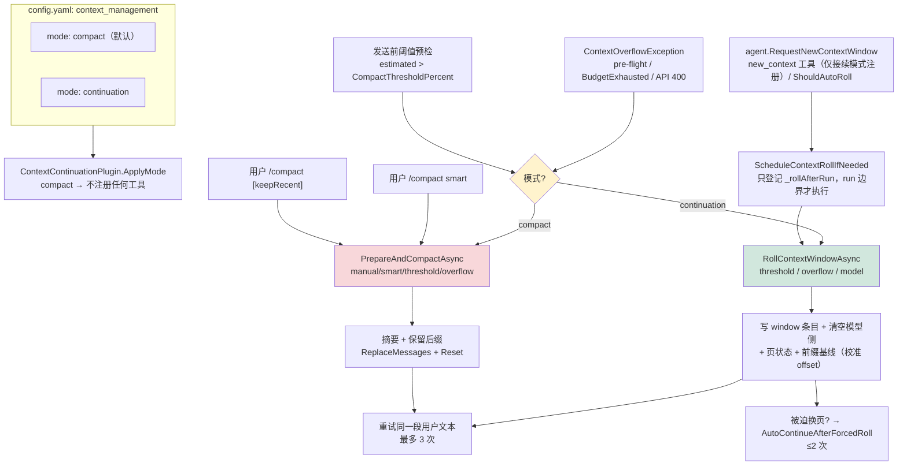
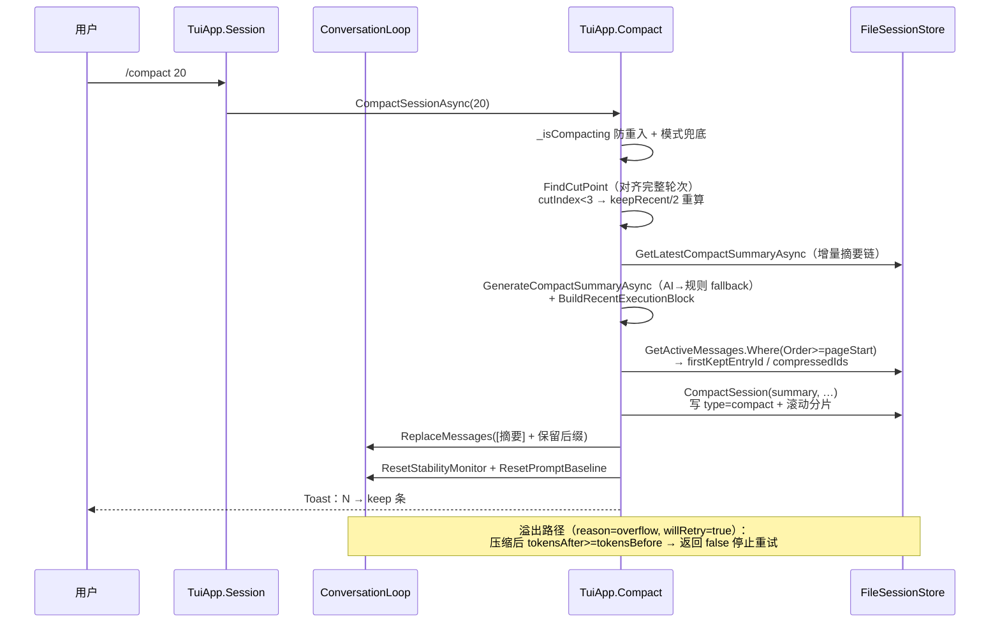
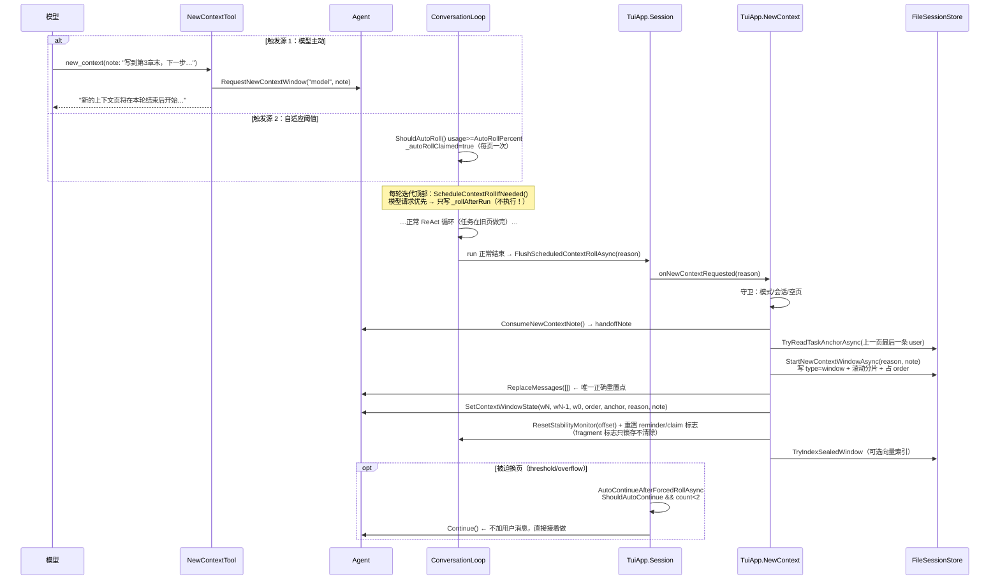
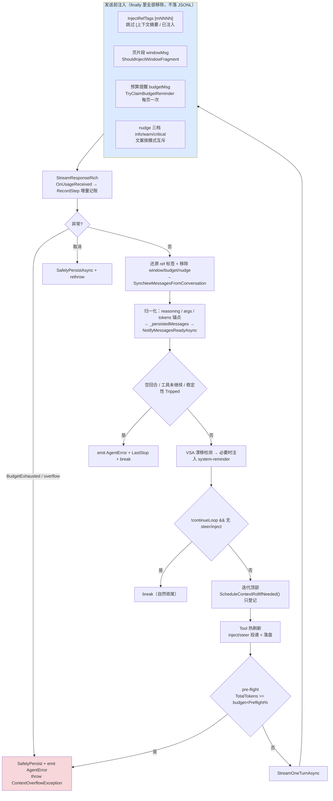
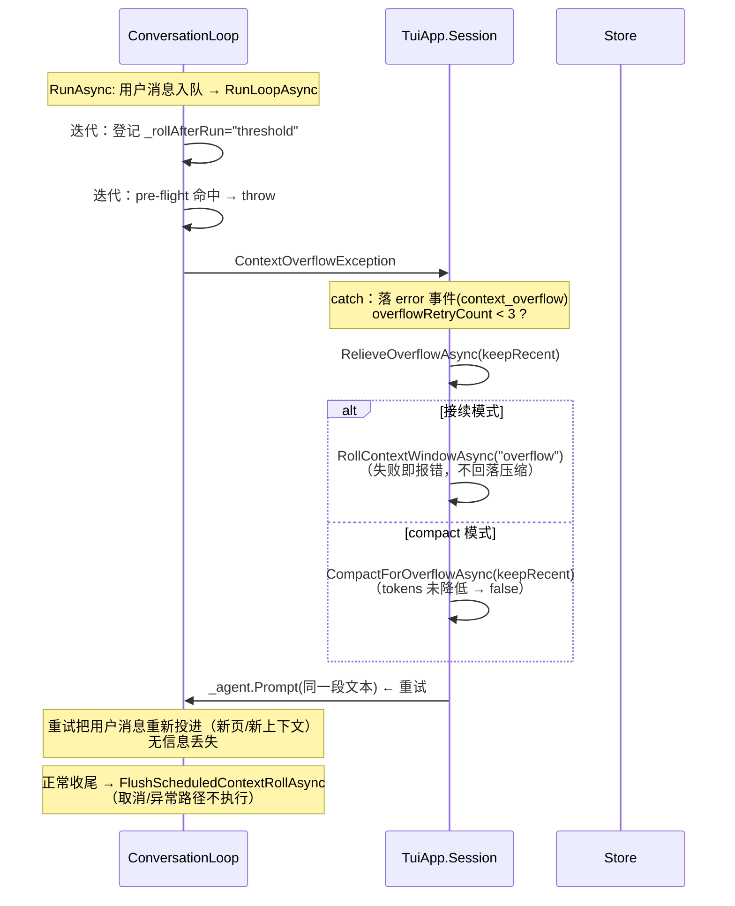
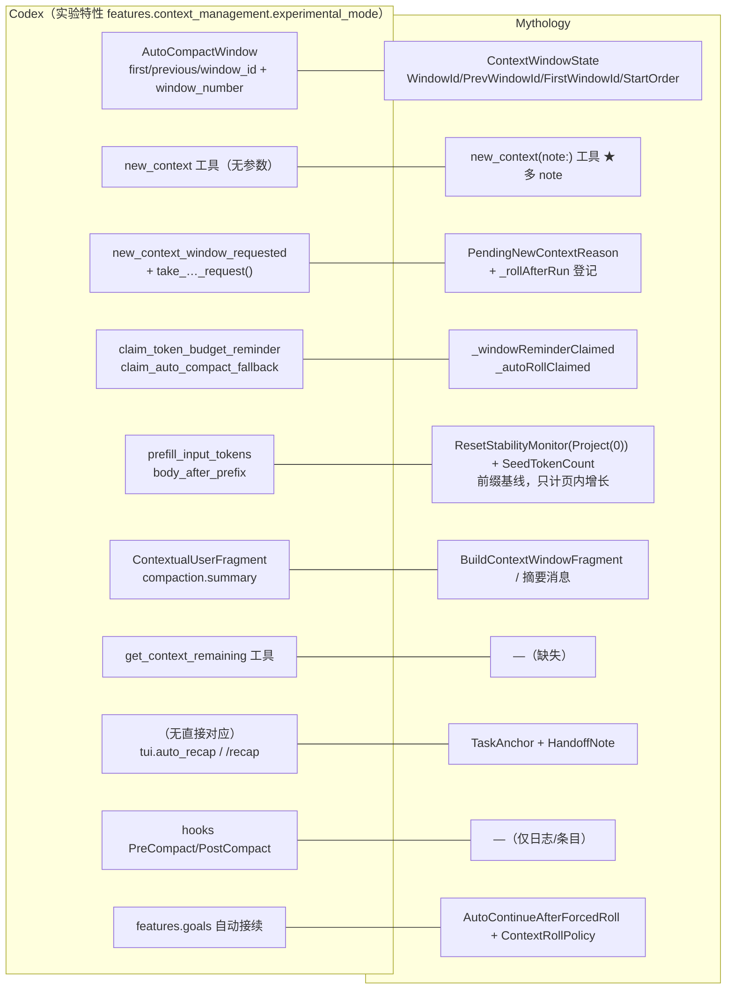

# 上下文管理两套逻辑全景：压缩（Compact）与移交（Continuation / 换页）

> 本文档只做**方案与分析**，不改代码。所有行号对照撰写时的源码，方法移动后以方法名为准。
> 核心文件：`src/Core/Agent/ConversationLoop.cs`（循环内判定与注入）、
> `src/Tui/TuiApp.Compact.cs` / `src/Tui/TuiApp.NewContext.cs` / `src/Tui/TuiApp.Session.cs`（Host 执行体）、
> `src/Plugins/ContextContinuation/*`（模型侧工具）、`src/Core/Data/FileSessionStore.cs`（落盘）。

---

## 0. 结论摘要（TL;DR）

1. **两套逻辑是「模式互斥」的一条上下文管理面**，不是两套并存系统：
   `ContextMode.Compact`（默认，有损摘要）vs `ContextMode.Continuation`（无摘要换页 + 历史检索）。
   互斥由 `ContextModeSwitcher` / `ContextContinuationPlugin.ApplyMode` 单点装配，Host 与 Loop 各有防御性守卫，
   **任何路径都不允许从换页回落到压缩**（`TuiApp.NewContext.cs:181-188`）。
2. **Loop 只做「判定 + 登记 + 运行时注入」，Host 才做「执行」**。这个切分是全部时序不变量的根源：
   - 压缩：Loop 抛 `ContextOverflowException`（pre-flight / BudgetExhausted / API 400），Host 捕获后压缩 + 重试同一段文本；
   - 移交：Loop 只把原因写进 `_rollAfterRun`，**run 正常结束后**才回调 Host 换页——中途换页会连本轮用户消息和工具结果一起清空。
3. **移交（换页）与 Codex 的实验特性对应关系非常好，几乎是同构设计**：
   Codex 的 `features.context_management.experimental_mode` 背后就是
   `AutoCompactWindow`（`first/previous/window_id` + `window_number` + `new_context_window_requested`）
   + `new_context` 工具（无参数）。我们的 `ContextWindowState` + `new_context(note:)` 是它的**超集**。
   **但它没有转正**：截至 0.162.1（2026-10-09）仍是 `Stage::UnderDevelopment` 最低档、默认关
   （详见 §5.0 的版本时间线）。
4. **本地明确领先 Codex 的一处**：`new_context(note:)` 的**交接说明（HandoffNote）**。Codex 的 `new_context`
   参数是空对象（`JsonSchema::object(BTreeMap::new(), None, false)`），没有任何交接通道；我们的 note
   落盘进 `JsonlWindowEntry.Note`、跨重启可恢复、并作为新页片段的第一段注入。
5. **本地落后 Codex 的两处**（§5.3 给出对齐方案）：`get_context_remaining` 式的模型主动查询、
   PreCompact/PostCompact 生命周期钩子。其余看似差距的项经核对均已对齐或本地更强：
   `body_after_prefix` 记账口径在换页路径**已经实现**（`Project(0)` 的校准 offset 即前缀基线，只计页内增长，见 §5.2）；
   `auto_recap` 是给用户看的 recap，不参与换页交接，我们的 note + 锚点是更强的对应物。

---

## 1. 代码地图：四层职责

| 层 | 文件 | 职责 | 关键方法 |
|---|---|---|---|
| **Loop（Core）** | `ConversationLoop.cs` | 阈值判定、登记、运行时注入（不持久化）、异常转译 | `ScheduleContextRollIfNeeded`(:393)、`FlushScheduledContextRollAsync`(:421)、`ShouldAutoRoll`(:367)、`TryClaimBudgetReminder`(:352)、`BuildContextWindowFragment`(:211)、`BuildBudgetReminder`(:277)、`BuildPressureNudge`(:322)、`RunLoopAsync`(:720)、`StreamOneTurnAsync`(:1058) |
| **Agent（Core）** | `Agent.cs` | 持有换页请求/交接说明的待决状态、页状态、回调槽 | `RequestNewContextWindow`(:179)、`ConsumeNewContextRequest`(:187)、`ConsumeNewContextNote`(:195)、`SetContextWindowState`(:206)、`OnNewContextRequested`(:217) |
| **模型侧工具** | `Plugins/ContextContinuation/NewContextTool.cs`、`HistoryTools.cs` | `new_context(note:)` 只置位；`history_*` 跨页检索 | `NewContextTool.ExecuteAsync`(:62) |
| **Host（执行体）** | `TuiApp.Compact.cs`、`TuiApp.NewContext.cs`、`TuiApp.Session.cs`（Desktop 同名见 `SessionEngine.cs`） | 压缩/换页的真实执行、重试、自动接续 | `PrepareAndCompactAsync`(:289)、`RollContextWindowAsync`(NewContext:56)、`RelieveOverflowAsync`(NewContext:181)、`AutoContinueAfterForcedRollAsync`(NewContext:190) |
| **Store** | `FileSessionStore.cs`、`JsonlDto.cs` | 滚动分片、compact/window 条目、按页检索 | `CompactSession`(:505)、`StartNewContextWindowAsync`(:619)、`GetWindowBoundaryAsync`(:723)、`ListHistoryItemsAsync`(:826) |

**两条链路的共同依赖（容易被忽略但很关键）**：

| 机制 | 作用 | 位置 |
|---|---|---|
| `StabilityMonitor` + `ModelContextProfile` | 所有阈值的唯一来源（pre-flight / auto-roll / nudge / reminder 全是 usage 比例） | `ModelContextProfile.cs` |
| `_lastPromptTokens` / `ComputeTurnIncrement` | 增量记账，避免每轮全量 prompt 重复累计 | `ConversationLoop.cs:1266-1300` |
| `ResetPromptBaseline()` | compact / 换页后必须重置，否则下一轮增量算出大幅负值、压低 TotalTokens 导致 pre-flight 漏检 | `ConversationLoop.cs:446` |
| `ResetStabilityMonitor()` | compact / 换页后真正 `Reset()` + `SeedTokenCount()`（不是只 `Unfreeze`）；换页路径 seed 的是**校准 offset**（= 前缀基线，只计页内增长） | `TuiApp.NewContext.cs:41-54` |
| `InjectRefTags` | `[mNNNN]` 引用标签；跳过 `[上下文摘要` 与已注入消息，保证压缩摘要不占 ref | `ConversationLoop.cs:2110-2140` |
| `NotifyMessagesReadyAsync` | 每轮落盘（不等 loop 结束），换页/压缩的安全性依赖它 | `ConversationLoop.cs:563` |

---

## 2. 压缩链路（Compact，默认模式）

### 2.1 四个触发源

| # | 触发源 | 入口 | reason |
|---|---|---|---|
| 1 | 用户 `/compact [keepRecent]` | `TuiApp.Compact.cs:33 CompactSessionAsync` | `manual` |
| 2 | 用户 `/compact smart`（RGDecimator 按信息密度选切割点） | `TuiApp.Compact.cs:77 CompactSessionSmartAsync` | `smart` |
| 3 | **发送前阈值预检**：估算全量 prompt > `CompactThresholdPercent`（1M→99.25% / 128K→96.5% / 8K→85%） | `TuiApp.Session.cs:107-112` | `threshold` |
| 4 | **溢出恢复**：pre-flight 抛异常 / `BudgetExhaustedException` / API 400 | `TuiApp.Session.cs:165-230` → `CompactForOverflowAsync`(:160) | `overflow` |

### 2.2 Loop 侧（只负责「抛」与「记账」）

```
RunLoopAsync 每轮迭代顶部（:810-847）
  └─ pre-flight：stabilityMonitor.TotalTokens >= budget × PreflightThresholdPercent
       ├─ SafelyPersistAsync()            ← 先把 inject/steer 落盘
       ├─ emit AgentError(IsContextOverflow:true, Recoverable:true)
       └─ throw ContextOverflowException  ← 两种模式都抛；模式分流在 Host

StreamOneTurnAsync（:1058+）
  ├─ catch BudgetExhaustedException  → emit + 包装成 ContextOverflowException（:1459-1470）
  └─ catch 通用异常 → ExtractLlmError 识别 isContextOverflow → 包装成 ContextOverflowException
```

注意：**pre-flight 在接续模式下同样抛异常**，注释明确「接续模式不在 run 中途换页，统一走溢出恢复」——
Host 捕获后换页并重试同一段文本，重试会把用户消息重新投进新页，无信息丢失。

### 2.3 Host 侧（`PrepareAndCompactCoreAsync`，`TuiApp.Compact.cs:335`）

```
1. FindCutPoint(messages, keepRecent)        ← 向前扫描到完整轮次起点（user 消息），
                                              避免 assistant+toolCalls 被拆到 compact 两侧（:462）
2. cutIndex < 3 且消息数 > keepRecent → 强制 keepRecent/2 重算（防御无效压缩）
3. previousSummary = GetLatestCompactSummaryAsync()   ← 增量摘要链
4. GenerateCompactSummaryAsync(AI 优先 / 规则 fallback) + BuildRecentExecutionBlock()
                                             ← 把被压缩区尾部的精确执行状态嵌进摘要
5. dbMsgs = GetActiveMessages().Where(Order >= pageStart)   ← ★ 必须按当前页切片，
                                            否则换页后 Skip/Take 会错位到旧页（compact 截断点跑到 window 之前）
6. firstKeptEntryId / compressedIds（跳过 EventType==Compact 的旧条目，防嵌套压缩混入）
7. _sessionStore.CompactSession(...)          ← 写 type=compact 条目 + 滚动分片（不删旧分片）
8. ReplaceMessages([summaryMsg] + keptMessages)  ← 摘要消息内容 = "[上下文摘要 {blockId}]\n{summary}" + novel 快照
9. CompressionBlocks.Add(blockId, ids, summary) ← 最小版可逆状态（decompress 用）
10. ResetStabilityMonitor(估算) + ResetPromptBaseline() + InvalidateContextMeasure()
11. _nextOrder++（compact 条目占一个 order 位）
```

**溢出专用附加逻辑**（`CompactForOverflowAsync:160`）：
- 消息数 ≤ keepRecent 且监控器处于冻结态 → 只 `Unfreeze` + 重设基线，不压缩；
- 压缩后 `tokensAfter >= tokensBefore` → 判定无效压缩，返回 false 让上层停止重试（防死循环）；
- `_isCompacting` 防重入（B4）：manual/smart/auto/overflow 四源在 `PrepareAndCompactAsync` 单点拦截；
- **模式兜底**：接续模式下走到这里直接返回 `RejectedWrongMode`（`TuiApp.Compact.cs` `PrepareAndCompactAsync` 的模式守卫）——压缩与换页混用会互相干扰。

**重试上限**：`TuiApp.Session.cs:170 maxOverflowRetries = 3`，耗尽后按模式给不同错误文案
（compact 模式提示 `/compact`；接续模式提示开新会话）。

---

## 3. 移交链路（Continuation / 换页）

### 3.1 概念模型：页（window）

- 页 = 一段**不携带任何历史摘要**的模型侧消息区间。首页 `w0` 隐式，不落条目；
  每换一页写一条 `type=window` 条目（`JsonlWindowEntry`：`window-id` / `prev-window-id` / `first-window-id` / `reason` / `note`）并滚动分片。
- 旧页消息**完整保留**在 JSONL 里，靠 `history_search_contents` / `history_read_item` / `history_list_*` 检索（可选向量语义检索，封页时异步建索引）。
- 页状态运行期载体 = `ContextWindowState`（`ContextWindowState.cs`）：
  `WindowId` / `PrevWindowId` / `FirstWindowId` / `StartOrder` / `TaskAnchor` / `RollReason` / `HandoffNote`。
- 恢复会话时由 `GetWindowBoundaryAsync`（`FileSessionStore.cs:723`）还原（`RollReason` + `HandoffNote` 从 window 条目读回，`TaskAnchor` 置 null）。
  这等价于 Codex 的 `restore_auto_compact_window`。

#### 移交前后：什么被丢弃、什么被保留

换页 = 「扔掉对话，留下抓手」。模型侧消息列表被整体清空（`ReplaceMessages([])` → `RestoreFromMessages([])` 重建 Conversation），
但**旧消息没有删除**，仍在 JSONL 里按页可检索。逐项对照：

| 内容 | 换页后还在模型上下文里？ | 载体 / 说明 |
|---|---|---|
| Prompt 骨架（角色定义→交互规范→写作流程→去AI味） | ✅ 一直在 | `BuildSystemMessageWithDirectory` 每次重建，**不属于页** |
| 用户自定义 system prompt | ✅ 一直在 | 同上 |
| **小说上下文**（世界观 / 角色 / 章节卷） | ✅ 一直在 | `Agent.SetNovelContext` 拼进 system prompt ⇒ **新页对「作品」不瞎**，只对「这次会话做过什么」瞎 |
| 动态工具目录 + 工具列表本身 | ✅ 一直在 | `toolInjector.BuildToolDirectory()`；常驻 + 已展开 + 非延迟工具 |
| **页片段** | ✅ 仅换页后的页注入 | 运行时注入的 user 消息，**发完即撤、不落 JSONL**：页 ID 三元组、本页剩余 token、**交接说明 note**（模型自愿写，≤500 字）、**任务锚点**（系统抓封页最后一条 user 消息，≤300 字）、切换原因、「未完成则直接继续，不必等用户发话」、`history_*` 检索入口、HiddenNotice |
| 下一条用户消息 | ✅ | 或被迫换页（threshold/overflow）时的自动接续 `Continue`——新页不等用户发话 |
| 上一页全部 user / assistant 消息 | ❌ 丢弃 | 未删除，`history_*` 可检索 |
| 上一页全部工具输出 | ❌ 丢弃 | 未删除；超大结果另有内容寻址缓存文件 |
| 上一页的预算提醒 / nudge / `[mNNNN]` ref 标签 | ❌ 丢弃 | 本来就是运行时注入，从不落盘 |
| 旧的 compact 摘要消息（会话若先压缩过） | ❌ 丢弃 | `BuildMessagesFromEntries` 的页截断：`Order ≤ 最新 window 行` 一律不进模型上下文，**重启恢复同样生效** |

**模型怎么找回**：`history_search_contents`（字面子串 + 可选语义，封页时异步建向量索引）、
`history_read_item`（按 entryId 读全文）、`history_list_windows` / `history_list_items`。这是 Codex 侧没有的本地增强。

**为什么必须「先扔再给」**：note 与锚点是**唯一**的跨页交接通道（Codex 的 `new_context` 连这个通道都没有，参数是空对象）；
而扔干净能让 provider 前缀缓存停在「system + 工具」这段**稳定前缀**上（这部分未变、仍可命中），会话部分从头建立，预算也回到接近满格。

### 3.2 三个触发源

| 触发源 | 判定处 | reason | 说明 |
|---|---|---|---|
| 模型主动 `new_context(note:)` | `ScheduleContextRollIfNeeded`(:393) 取走 `agent.PendingNewContextReason` | `model` | 工具只置位（`NewContextTool.cs:73`），不执行 |
| 自适应阈值：usage ≥ `AutoRollPercent` | `ShouldAutoRoll`(:367) | `threshold` | 每页至多一次（`_autoRollClaimed` 防抖，无论成败） |
| 溢出恢复 | pre-flight 抛异常 → `RelieveOverflowAsync` → `RollContextWindowAsync("overflow")` | `overflow` | **不回落压缩** |

### 3.3 「登记 → run 边界执行」两段式（本设计最核心的不变量）

为什么不能 run 中途换页：`ReplaceMessages([])` 会把**本轮刚收到的用户消息与本轮工具结果**一起清掉，
模型在新页上既看不到任务，也没有可检索的线索。因此：

```
RunLoopAsync 开头（:726-733）  丢弃上一次 run 的残留登记（中断/异常时未执行的）
        │
每轮迭代顶部（:754）           ScheduleContextRollIfNeeded()：只写 _rollAfterRun，不执行
        │                      优先级：模型请求 > 自适应阈值；本 run 已登记则先到先得
        …正常 ReAct 循环…
        │
RunAsync / ContinueAsync 尾部（:685 / :710）
        └─ FlushScheduledContextRollAsync(reason) → onNewContextRequested(reason)
             ← 此时消息已落盘、UI 已收尾，换页只影响下一页的模型上下文（Codex 同款语义）
```

取消 / 异常路径**不执行**换页，登记在下一个 run 开头被清掉。

### 3.4 Host 执行体 `RollContextWindowAsync`（`TuiApp.NewContext.cs:56`）

```
0. 守卫：模式必须是 Continuation；无会话/无 novel → false；本页消息数为 0 → false（空页不换，防原地打转）
1. handoffNote = _agent.ConsumeNewContextNote()      ← 模型自写交接说明（≤500 字，截断）
   taskAnchor  = TryReadTaskAnchorAsync(上一页)      ← 封页最后一条 user 消息（≤300 字，截断）
2. StartNewContextWindowAsync(reason, note)          ← 写 window 行 + 滚动分片 + 占用一个 order
3. _agent.ReplaceMessages([]) + _persistedMessageCount = 0   ← 唯一正确的模型侧重置点（UI 面板不动）
4. _agent.SetContextWindowState(new ContextWindowState(…))   ← 内部重置提醒标志 + prompt 基线
5. ResetStabilityMonitor(Project(空页估算)=校准 offset)   ← 前缀基线（=body_after_prefix），下一轮增量只算页内增长
6. TryIndexSealedWindow(上一页)                       ← vector_retrieval=true 时 fire-and-forget 建索引
```

### 3.5 新页的运行时注入物（`StreamOneTurnAsync`，**发送后全部移除，不落 JSONL**）

> 注入项「是什么」见 §3.1 的移交前后对照表；本节只讲**何时注入、发完后在哪移除**。

| 注入物 | 条件 | 内容 | 移除点 |
|---|---|---|---|
| 页片段 `windowMsg` | `ShouldInjectWindowFragment()` = 接续模式 && 已换过页/恢复过页状态 | 首页/当前/上一页 ID、本页剩余 token、**上一页交接说明**、**任务锚点**、切换原因、"未完成则直接继续"指令、`history_*` 检索入口、HiddenNotice | `finally`(:~1360) |
| 预算提醒 `budgetMsg` | `TryClaimBudgetReminder`（usage ≥ `RollAdviceRatio`，**每页一次**） | 剩余 token + 当前请求（截断 120 字）+ 要求收尾并调 `new_context` | 同上 |
| 压力 nudge `nudgeMsg` | 三档 info/warn/critical（`ModelContextProfile` 推导，保证 info<warn<critical<preflight） | **模式互斥文案**：compact → 建议用户 `/compact`；接续 → 调 `new_context` | 同上 |
| ref 标签 | 每轮全部 user 消息 | `[mNNNN]`（EntryId 锚定，跨压缩稳定；跳过摘要消息） | `finally` 还原 Content |

### 3.6 自动接续（本地产品化增强，非 Codex 语义）

`ContextRollPolicy`：**只有被迫换页**（`threshold` / `overflow`）才自动接续，模型主动 `new_context` 不代它继续；
同一条用户消息下最多 2 次（`MaxAutoContinuesPerUserMessage`），用户发新消息即清零预算（`TuiApp.Session.cs:116-117`）。

---

## 4. 两套逻辑差异对照

| 维度 | Compact（压缩） | Continuation（移交） |
|---|---|---|
| 信息损失 | 有损：旧消息 → AI/规则摘要（可 decompress 恢复原文） | 无损：旧消息原样留在 JSONL，靠 `history_*` 检索 |
| 模型侧消息 | 摘要消息 + 保留后缀（`[上下文摘要 bN]` 占一条 user） | 空（或仅有新用户消息） |
| 上下文前缀缓存 | 摘要文本变化 → 前缀失效，整段重新建立 | 清空 → 「system + 工具」稳定前缀未变、仍可命中，仅会话部分从头建立 |
| 触发工具 | 无模型侧工具（`/compact` 是用户命令；nudge 建议用户执行） | `new_context` 模型自主 |
| 执行时机 | Host 捕获异常后立即压缩 + 重试同一文本 | run 边界（正常结束）执行；异常路径走溢出分支 |
| 失败语义 | 无效压缩 → 停止重试并报错 | 换页失败 → **报错，不回落压缩** |
| 恢复/续做 | 摘要 + `BuildRecentExecutionBlock` 精确执行状态 | 交接说明 + 任务锚点 + history_* |
| 记账重置 | `ResetStabilityMonitor` + `ResetPromptBaseline` | 同左 + `_windowReminderClaimed` / `_autoRollClaimed` 重置（`_windowFragmentActive` **只锁存、永不清除**：`SetContextWindowState` 里是 `||` 累加，分支回溯复位到首页时仍要注入片段） |
| 持久化条目 | `type=compact`（含 `compressed-message-ids`，可逆） | `type=window`（含 `note`） |

---

## 5. 与 Codex 实验特性的对应关系（重点）

### 5.0 成熟度结论（2026-10-14 核查，回答「有没有转正」）

**没有转正——连 Experimental 档都没进，仍停在最低档 `UnderDevelopment`。**

Codex 官方成熟度阶梯（`codex-rs/features/src/lib.rs` 的 `Stage` 枚举，官方文档同款分级）：
`UnderDevelopment`（"Not ready for use. Don't use."）→ `Experimental`（"Use at your own risk."）→
`Beta` → `Stable`（"Safe for production use."）→ `Deprecated` → `Removed`。

当前 main / 最新发布版 **0.162.1（2026-10-09，npm `@openai/codex` latest）** 的注册表原文：

```rust
FeatureSpec { id: Feature::TokenBudget,       key: "token_budget",       stage: Stage::UnderDevelopment, default_enabled: false },
FeatureSpec { id: Feature::ContextManagement, key: "context_management", stage: Stage::UnderDevelopment, default_enabled: false },
```

`Stage::UnderDevelopment` 是整条阶梯的**最低一档**（比 Experimental 还低一级），默认关闭；
开启后启动时会推 "Under-development features enabled: context_management …" 警告
（可用 `suppress_unstable_features_warning = true` 压掉）。官方 config-reference 到今天仍写着
"Experimental context-management setting. **The feature is not currently available.**"

**版本时间线（都查证过）：**

| 版本 / PR | 日期 | 事件 |
|---|---|---|
| PR #27488 | 2026-06 | 在 `Feature::TokenBudget` 后加入 direct-model-only `new_context` 工具；请求存进 `AutoCompactWindow`、sampling 后消费；新窗口 = **无摘要压缩检查点**（只带全新初始上下文）；带 "Current context window Z" 消息让模型知道自己在第几窗 |
| PR #42385 → **0.153.0** | 2026-09-03 | 加入 `features.context_management.experimental_mode` 配置与 schema；**仅** ChatGPT Plus/Pro/Pro Lite + Codex 后端生效，激活 token-budget context + history notes + `new_context`；API-key 会话、自定义 provider、临时结构化线程一律排除 |
| **0.154.0** | 2026-09-09 | #43147：按模型能力门禁——模型目录必须 advertised `supports_experimental_context`，否则启动即不激活 |
| PR #29743 | 2026-09 | token-budget 压缩也走 `new_context` 语义：手动 `/compact` 与内联自动压缩都**本地装新窗口**（不调服务端/本地摘要），但保留 compact 生命周期副作用（pre/post compact hooks + `TurnItem::ContextCompaction`） |
| 0.162.0 / **0.162.1** | 2026-10-08/09 | 至今 `codex features list` 里仍是 `context_management  under development  false`（第三方实测 0.153.4 同款输出）；`remote_compaction_v2` 已被标 **Removed**，改为 0.162.0 起对自定义 Responses 兼容 provider 开放 live web + remote compaction |

**周边项的转正情况（同一次核查）**：`goals`（持久化目标 + 自动接续）**已 Stable**、`memories` **已 Stable**（默认关）、
`guardian_reuse_parent_compaction` **Stable**、`compaction_image_budget` **Stable**；而 `token_budget` / `async_compaction` /
`guardian_root_handoff_context` / `retain_client_developer_messages` / `retain_client_tool_outputs` 仍 UnderDevelopment。

> 对我们的含义：本地换页链路不必等 Codex 转正再对齐——它的机制文档（PR + 源码）已经稳定可读，
> 而官方可用性反而落后于我们。若将来它升到 Beta/Stable，重点复查两点：`new_context` 是否补上参数（交接通道）、
> token-budget 压缩的"无摘要重置"是否成为 `/compact` 的默认语义（那会改变 §4 表格里 compact 行的定义）。

### 5.1 Codex 侧事实（截至当前 main 分支）

| Codex 元素 | 事实 | 出处 |
|---|---|---|
| `features.context_management.experimental_mode` | 配置键（docs 记法）；注册表里的真名是裸布尔 `context_management`，**`Stage::UnderDevelopment`、默认 false**——见 §5.0，未转正 | `codex-rs/features/src/lib.rs`（FEATURES 表）；官方 config-reference（"not currently available"）；`codex features list` 实测 |
| `AutoCompactWindow` | 页状态机：`first_window_id` / `previous_window_id` / `window_id`（Uuid v7）/ `window_number` / `new_context_window_requested` / `token_budget_reminder_delivered` / `auto_compact_fallback_delivered` / `prefill_input_tokens` | `codex-rs/core/src/state/auto_compact_window.rs` |
| `SessionState` | `request_new_context_window()` / `take_new_context_window_request()` / `start_new_context_window()` / `advance_auto_compact_window()` / `restore_auto_compact_window()` / `claim_token_budget_reminder()` / `claim_auto_compact_fallback()`；历史替换后 `clear_prefill()` | `codex-rs/core/src/state/session.rs` |
| `new_context` 工具 | 名称就是 `new_context`，**参数为空对象**（无 note）；描述 "Start a new context window. Does not clear, reset, or otherwise affect environment state."；返回 "A new context window will start without summarizing conversation history."；有 `AutoCompactionDisabled` 守卫（线程禁用上下文重置时报错） | `tools/handlers/new_context_window.rs`、`new_context_window_spec.rs` |
| `get_context_remaining` 工具 | 模型可主动查询剩余 token（`tokens_left`，未知时渲染 unknown 片段） | `tools/handlers/get_context_remaining.rs` |
| 压缩阈值口径 | `model_auto_compact_token_limit` + `model_auto_compact_token_limit_scope = total \| body_after_prefix`；`body_after_prefix` 只计「携带的压缩窗口前缀之后」的增长，基线 = `prefill_input_tokens`（服务端观测优先于估算） | config-reference + `auto_compact_window.rs` |
| 压缩提示词可配 | `compact_prompt` / `experimental_compact_prompt_file` | config-reference |
| 服务端压缩 | `model_providers.<id>.capabilities.remote_compaction = unsupported \| v2`（v2 通过 Responses 下发压缩触发）；`features.remote_compaction_v2` 已被标 **Removed**，0.162.0 起改为对自定义 Responses 兼容 provider 开放 remote compaction | config-reference + `features/src/lib.rs` |
| 生命周期钩子 | `hooks.PreCompact` / `hooks.PostCompact` | config-reference |
| 生成式交接 | `tui.auto_recap`（终端失焦时自动生成会话 recap）+ `/recap` 命令 | config-reference |
| 目标与续做 | `features.goals`（持久化目标 + 自动接续）**已 Stable**、`features.memories` **已 Stable**（默认关）、`memory_tool` | config-reference + `features/src/lib.rs` |
| 其他可比项 | `tool_output_token_limit`（≈我们的 `ScaledToolResultMaxChars`）、`features.rollout_budget.reminder_interval_tokens`（≈我们的每页一次预算提醒，但它是间隔制）、`suppress_unstable_features_warning`、`guardian_root_handoff_context` / `guardian_reuse_parent_compaction`、`features.compaction_image_budget` | config-reference / schema |

### 5.2 概念映射表（本地 ↔ Codex）

| 本地（Mythology） | Codex | 吻合度 |
|---|---|---|
| `ContextWindowState.WindowId / PrevWindowId / FirstWindowId / StartOrder` | `AutoCompactWindowIds` + `window_number` + segment `StartOrder` | ★★★ 几乎同构（我们用 `wN` 字符串，Codex 用 Uuid v7） |
| `ScheduleContextRollIfNeeded` 模型请求优先 + `_rollAfterRun` 登记 | `new_context_window_requested` + `take_new_context_window_request()` | ★★★ 同为「只置位、稍后执行」 |
| run 边界 `FlushScheduledContextRollAsync` | `start_new_context_window()` / `advance()` | ★★★ 同为 run/turn 边界推进 |
| `_windowReminderClaimed` / `TryClaimBudgetReminder`（每页一次） | `claim_token_budget_reminder()` | ★★★ 同款 claim-once 语义 |
| `_autoRollClaimed`（每页一次防抖） | `claim_auto_compact_fallback()` | ★★☆ 语义对应（我们的自适应换页 vs 它的压缩兜底） |
| `BuildContextWindowFragment`（页 ID + 剩余量 + 交接 + 检索入口） | `ContextualUserFragment` 系列（`compaction.summary` 等 user 角色内部片段） | ★★★ 同为「user 角色承载的系统内部片段、对用户隐藏」 |
| `RollContextWindowAsync("overflow")` 后重试同一文本 | pre-flight/溢出后压缩或换页 + 重试 | ★★★ |
| `AutoContinueAfterForcedRollAsync` + `ContextRollPolicy` | `features.goals`（自动接续） | ★★☆ 我们内置在 Host，Codex 是独立 feature |
| `TaskAnchor`（封页最后一条 user 消息，规则式） | —（无直接对应；`tui.auto_recap`/`/recap` 是终端失焦时给用户看的会话 recap，不参与换页交接） | ★☆☆ 仅语义相近，本地以更强形式覆盖 |
| **`HandoffNote`（`new_context(note:)`，≤500 字，落盘可恢复）** | **无对应（`new_context` 参数为空对象）** | ★☆☆ **本地领先** |
| `GetWindowBoundaryAsync` 恢复页状态 | `restore_auto_compact_window` | ★★★ |
| compact 模式（`/compact`、摘要链、decompress 可逆） | Codex 的 auto-compact（`compact_prompt` 可配） | ★★☆ 我们的摘要可逆是本地独有 |
| 无 | `get_context_remaining` 工具 | ☆☆☆ **本地缺失** |
| `ResetStabilityMonitor(Project(0))` + `ResetPromptBaseline` | `body_after_prefix` + `prefill_input_tokens`（携带前缀基线，只计增长） | ★★★ **已对齐**：`Project(0)` 返回校准出的固定开销 `_offset`（system + 工具定义 + 小说上下文）作为前缀基线；`SeedTokenCount(offset)` 后首轮增量走 seeded 分支（= completion），次轮起 `prompt − lastPrompt + completion`——只计页内增长。与 Codex「服务端观测优先、估算兜底」的差别仅在于我们用校准 offset、下一轮用实测 prompt 修正基线 |
| 无 | `hooks.PreCompact/PostCompact` | ☆☆☆ 本地缺失（我们只有日志 + event 条目） |
| `history_*` 工具集 | 无直接对应（Codex 靠 rollout 文件与 guardian history 工具） | — 本地领先 |
| `ScaledToolResultMaxChars` + 缓存文件 | `tool_output_token_limit` | ★★★ |

**结论：移交（换页）链路与 Codex 的实验特性对应得非常完整**——从页 ID 三元组、请求置位、
turn 边界推进、claim-once 提醒，到溢出重试和恢复，逐项都能对上；Codex 那一侧目前只是一个
尚未开放的实验开关（`experimental_mode` 文档明写 not currently available），
**我们实际上已经实现了它宣称要做的全部机制，并多出 note 交接与可逆压缩两块**。

### 5.3 差距与对齐方案（仅方案，不动代码）

> 已核销的「假差距」：~~换页后改用携带前缀基线记账~~ —— 换页路径现状即 `body_after_prefix`
> （`TuiApp.NewContext.cs:116` 用 `Project(EstimateContextTokens([]))` 取校准 offset 作前缀基线 +
> `ResetPromptBaseline()` 让首轮增量只算 completion），无需改动；compact 路径同样在压缩后重设基线
> （`TuiApp.Compact.cs:439`），与 Codex `replace_annotated_history → clear_prefill` 同义。

| # | 方案 | 对应 Codex | 动机 | 代价 / 风险 | 建议优先级 |
|---|---|---|---|---|---|
| A | 新增 `get_context_remaining` 等价能力：把 `RemainingTokens()` 暴露成一个隐藏工具（HiddenTools 过滤 UI） | `get_context_remaining` | 现在剩余量只在「页片段 + 每页一次提醒」里出现，模型在页内中段想主动判断却没有通道；nudge 三档是循环推的，不是模型拉的 | 小；需进 HiddenTools + 接续模式才注册；注意与预算提醒重复推送 | 中 |
| C | `new_context(note:)` 保持可选但补一个**结构化**降级路径：note 缺省时自动生成「上一页最后一条 user 消息 + 最近 N 条工具名」的规则锚点（现在只有 `TaskAnchor` 一条 user 消息） | —（Codex 无对应；`auto_recap` 是给用户看的 recap，不参与换页交接） | 模型不写 note 时新页只有一条裸 user 锚点，跨页续做信息稀薄 | 小；纯规则、无 LLM 调用；注意别让锚点变贵（现在锚点在每轮片段里都出现） | 高（便宜且直接改善跨页续做） |
| D | 压缩/换页生命周期事件化：落 `SessionEvent`（`PreCompact`/`PostCompact` 等价物），供插件/审计订阅 | `hooks.PreCompact/PostCompact` | 现在只有日志与 `type=compact/window` 条目，外部无法在压缩前后插话 | 中；要定事件 schema（kebab-case 键 + 契约测试） | 低 |

---

## 6. 详细流程图

### 图 1 —— 总控：模式互斥与触发源分流



### 图 2 —— 压缩（Compact）全流程



### 图 3 —— 移交 / 换页（Continuation）全流程



### 图 4 —— 单轮循环内部时序（`RunLoopAsync` → `StreamOneTurnAsync`）



### 图 5 —— run 边界换页 + 溢出重试的时序细节



### 图 6 —— Codex ↔ 本地 概念映射



---

## 7. 关键不变量与风险清单

**时序不变量（改这里前先读）**

1. 换页/压缩必须发生在 `StreamOneTurnAsync` **之外**；循环内只登记。
2. `_agent.ReplaceMessages([])` 是模型侧消息唯一正确重置点；`_persistedMessageCount` 必须与列表清空绑定，否则旧消息整段重复写 JSONL。
3. `_nextOrder` 只递增：window 行 / compact 行各占一个 order。
4. 运行时注入物（ref 标签 / 页片段 / 预算提醒 / nudge）必须在 `SyncNewMessagesFromConversation` **之前**还原或移除，否则污染 JSONL 并破坏 provider 前缀缓存。
5. 模式互斥不回落：接续模式换页失败 = 报错；compact 模式不产生 window 条目。

**防抖 / 幂等**

- `_autoRollClaimed`、`_windowReminderClaimed` 每页一次，换页/恢复时重置（`SetContextWindowState`）。
- `_isCompacting` 压缩防重入（B4）；`RequestNewContextWindow` 重复请求只保留首个 reason / 首条 note。
- `AutoContinue` 每用户消息 ≤2 次；溢出重试 ≤3 次。

**已识别的设计性风险（供后续方案参考，本文档不改码）**

| 风险 | 现状缓解 | 残留问题 |
|---|---|---|
| `_lastPromptTokens` / TotalTokens 在 compact 后失真 | `ResetPromptBaseline()`（B6） | 换页路径已是对齐 Codex `body_after_prefix` 的前缀基线记账（§5.2）；compact 路径 seed 的是字符估算投影，误差由下一轮实测 prompt 差分自然修正 |
| 交接说明/锚点每轮出现在片段里 | note ≤500 字、锚点 ≤300 字、请求引用 ≤120 字 | 片段只带**当前页**的一条 note + 一条锚点（标量读取），成本 O(1)、不随页数增长；残留风险是**过期锚点把模型拽回已完成的任务**（已由片段里「用户已给出新任务则以新任务为准」缓解，`ConversationLoop.cs:236-241`） |
| compact 切割点与页边界错位 | `pageStart` 过滤（`TuiApp.Compact.cs:373`） | 内存/DB 消息数不一致时只记日志不阻断 |
| 模型不写 note | `TaskAnchor` 兜底 | 锚点只有一条 user 消息，跨页续做信息稀薄（见方案 C） |
| 自动接续可能重复劳动 | 模型自行判断完成即停 | 无「已完成」显式信号，靠模型自然停止 |

**模式互斥的三层守卫（切到 continuation 后 `/compact` 会怎样）**

不会出问题，也**不会**悄悄产生 compact 条目——由内到外三层拦死：

| 层 | 位置 | 行为 |
|---|---|---|
| ① 命令入口 | `TuiApp.Commands.cs:344-349` | continuation 模式下 `/compact` 直接 Toast「接续模式不使用压缩：上下文接近上限时会自动开启新页。」后 `break`，不进压缩逻辑 |
| ② 触发点 | `TuiApp.Session.cs:107-112`（发送前阈值预检）、`TuiApp.NewContext.cs:181-188`（溢出恢复） | 预检：continuation → `RollContextWindowAsync("threshold")`，compact → `AutoCompactAsync`；溢出：continuation → 换页，compact → 压缩，**接续模式换页失败直接报错、绝不回落压缩** |
| ③ 执行体兜底 | `TuiApp.Compact.cs` `PrepareAndCompactAsync` | 万一前面漏判，见到 continuation 模式直接拒绝并记诊断日志（单点兜底，见下） |

**已修掉的文案陷阱（`CompactResult.Rejected` 拆分）**：拒绝原因原先只有一档 `Rejected`，却混了两种语义——
① B4 防重入（真在压缩中，可重试）② 模式互斥（接续模式，重试永远无用）。
旧代码对两者一律提示「压缩进行中，请稍候再试」；一旦未来新增触发源漏判模式，用户会看到完全错误的提示。
现已拆为 `RejectedInProgress` / `RejectedWrongMode`（TUI 与 Desktop `SessionEngine` 同批改，文案分开），
且溢出路径的返回值也随之分开：`RejectedInProgress` → `true`（交上层重试），`RejectedWrongMode` → `false`（停止重试并报错，
因为什么都没做、重试无用）。

**验证建议（仅当后续真要落地时；本文档不改码、不跑测试）**

1. 钉死 §5.2 的记账论断：校准后换页，断言 `StabilityMonitor.TotalTokens == calibrator.Project(0)`，且换页后首轮
   `ComputeTurnIncrement(null, p, c, seeded: true) == c`（只计增长）——即换页路径确为前缀基线口径。
2. 断言 `_windowFragmentActive` 在第二次换页后仍为 true（锁存语义，对应 §4 表格修正）。
3. 图 1 不应存在「换页请求触发源 → compact 分支」的边（compact 模式下 `new_context` 未注册、`ShouldAutoRoll` 恒 false）。
4. 若要跑测试：`dotnet test src/Tui/Tests/Tui.Tests.csproj`，**不要加 `--nologo`**（本机 SDK + MTP 会把它转进测试进程造成假失败）。

---

## 8. 一页速查

- **压缩**：`/compact` / 阈值预检 / 溢出 → `PrepareAndCompactAsync` → 摘要 + 保留后缀 → 重试（≤3）。
  （接续模式下被三层守卫拦死：命令入口 Toast / 触发点改道换页 / 执行体返回 `RejectedWrongMode`。）
- **移交**：`new_context(note:)` 或自适应阈值 → 循环只登记 → run 结束 `RollContextWindowAsync`
  → 写 window 条目 + 清模型侧 + 页状态 + 前缀基线 → 被迫换页则自动接续（≤2）。
  新页初始上下文 = system prompt（含小说上下文）+ 页片段（note / 锚点 / 页 ID / 剩余量 / `history_*` 入口）；
  旧消息不删，按页可检索。
- **对 Codex**：换页 = Codex 实验特性的完整落地（页 ID / 请求置位 / turn 边界推进 / claim-once 提醒）；
  `note` 交接是本地独有的增强；Codex 侧至今（0.162.1）仍 `UnderDevelopment` 未转正，
  `get_context_remaining` 与 Pre/PostCompact 钩子是仅存的两处待对齐项。
