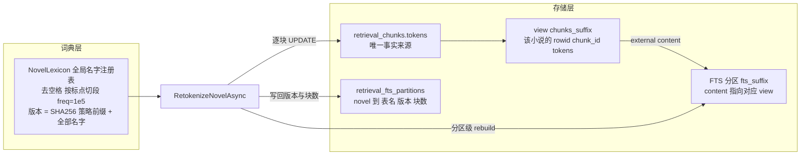
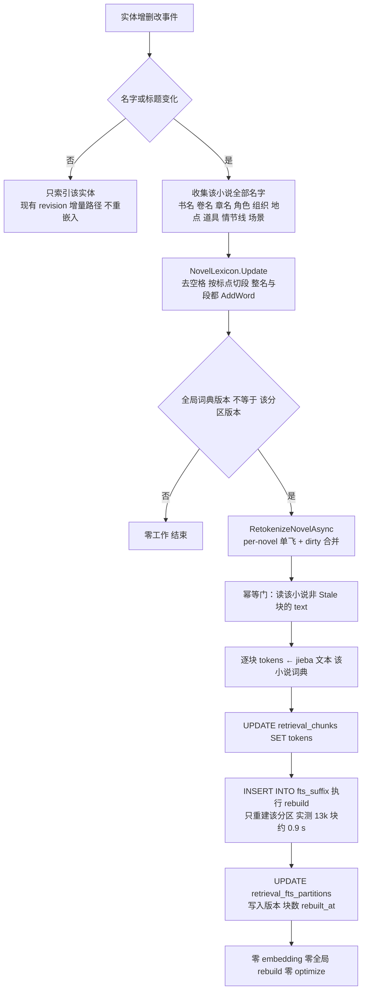
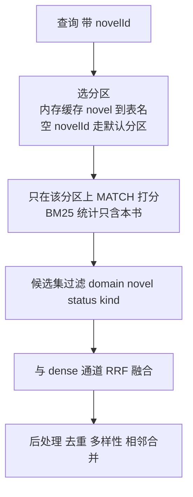
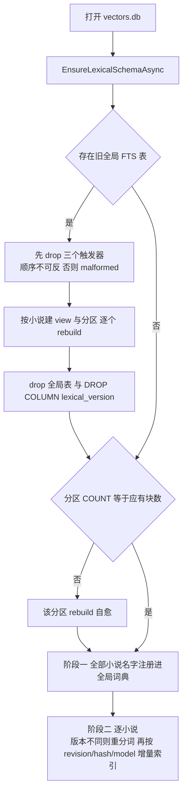

# 词法方案 v3：词典修正 + 每部小说独立 FTS 分区 + 只重分词的 hot reload

> 状态：**已实施**（v7）。验证：Core 1523/1523、Tui 857（1 skip）、真实库副本迁移 + 重分词冒烟（76 块 30 ms、零 embedding、三魂归一 无命中 → 命中、BM25 分区隔离）。关联提交：`aba5975`（FTS 改 jieba 预分词 tokens）、`3104a36`（每部小说独立 jieba 词典）、
> `ec5c6b8`（实体名称变更实时刷新词典）。参考实现：`~/Documents/GithubProjects/SAG-Benchmark/sag2`。
> 相关文档：`docs/vec.md`（§2.2 字段表、§2.7 降级链）。

## 0. 一句话

架构是 **FTS5 + BM25 ← jieba 预分词 ← 实体词典防切错**，这条链保留。要修的是链上四处**实测失效**：
① 词频 10 太低、② 含空格名被丢、③ JiebaNet 词典实际是进程全局而版本号按小说算、
④ **所有小说共用一张 FTS 表，导致 BM25 统计跨书污染、维护与查询成本随全库增长**。
修完词典后，词典变化只重建**该小说的 FTS 分区**（实测 13k 块 0.9 s），不再重嵌入、不再整库 rebuild。

## 1. 四个问题，全部有实测

### 1.1 成本：词典一变就全量重嵌入（纯浪费）

`VectorSyncService.IsUpToDate`（`src/Core/Data/VectorSyncService.cs:521-533`）把小说级 `lexical_version`
当作文档级过期条件 ⇒ 改名后该小说所有文档被 `RetrievalKernel.IndexDocumentAsync`
（`src/Core/Vector/RetrievalKernel.cs:341-428`）无条件重新 embedding。但词典只影响 FTS 的 `tokens` 列
（`SqliteRetrievalStore.cs:1256`），embedding 输入是原始块文本（`RetrievalKernel.cs:354-356`），与 jieba 无关。

| 规模 | 块数 | 只重分词（jieba 稳态） | 重嵌入输入 |
|---|---|---|---|
| 100 章 / 30 万字 | 1 298 | 219 ms | 36 万字符，约 200 次网络往返 |
| 1000 章 / 300 万字 | 12 980 | 1 828 ms | 361 万字符，约 2000 次网络往返 |

### 1.2 词典三处失效（逐进程隔离测量，避免 jieba 全局状态污染）

**(a) `freq=10` 不够。** JiebaNet 的 `Calc` 给候选边打分 `log(freq) − log(Total) + route[x+1]`，
**每多切一个词多付一次 `−log(Total)`**，于是「整名 vs 切 k 段」的判据是

```
f_整名 > (∏ f_第i段) / Total^(k−1)          Total = 60,101,967
```

两字名只剩 `f_整名 > f_A·f_B/Total`：`善我` 需 > **31.9**、`恶我` > **17.2**、`有我` > **2,318**，
最坏上界 =（最高频单字 883,634）²/Total ≈ **12,991**；三字名分母是 `Total²`，阈值趋近 0。

| 名字 | 竞争切分 | 需要 freq > | freq=10（现状） | freq=100 | freq=1e5 |
|---|---|---|---|---|---|
| 善我 | 善/我 | 31.9 | 善/我（碎） | 善我 ✔ | 善我 ✔ |
| 恶我 | 恶/我 | 17.2 | 恶/我（碎） | 恶我 ✔ | 恶我 ✔ |
| 有我 | 有/我 | 2,318 | 有/我（碎） | **有/我（仍碎）** | 有我 ✔ |
| 皮皮龙 / 松雪美乃 / 陈折花 | 多段 | ≈0 | ✔ | ✔ | ✔ |

12 名集合：`freq=10` 漏 2/12，`freq=1e5` 全过；对照句（「陈旧的折扇花了大价钱」等）在 100/1e5/1e6 下与默认分词逐字一致。
另一条边界：同 freq 下「长名」要压过「它的短子名」需 `F < Total`，故合法区间 **(12,991, 60,101,967)**，取 **100,000**。
`LexicalText.Tokenize` 还会过滤停用词（表里有「我」）——两字名被切碎后只剩一个「善」，等于**从 FTS 里蒸发**。

**(b) 含空格的实体名根本没进词典。** 归一化过滤 `!name.Any(char.IsWhiteSpace)`（`NovelLexicon.cs:31-35`）
丢掉「小森 星罗」，而真实角色 5 个里 4 个是这种形态。实测：默认 `小森星/罗站`；原名注册**无变化**（被丢弃）；
去空格注册 `小森星罗 站`。

**(b2) 各类实体都要靠词典：没有词典，默认 jieba 只有 10% 的名字能保住整名。**
用 `novels/2c2410d54e08` 的真实数据（角色 5 / 地点 9 / 情节线 6 / 场景 7 / 章节 11 / 书名 1），
每个名字在 5 个句子模板里检查「名字是否整名出现」：

| 实体类型 | 默认 jieba 整名 | 词典（去空格 + freq=1e5）整名 |
|---|---|---|
| 角色 5 个 | 10/25（40%） | 25/25 |
| 地点 9 个 | **4/45（9%）** | 45/45 |
| 情节线 6 个 | **0/30（0%）** | 30/30 |
| 场景 7 个 | 5/35（14%） | 35/35 |
| 章节 11 个 | **0/55（0%）** | 55/55 |
| 书名 1 个 | 0/5 | **0/5（见 (b3)）** |
| 合计 | **19/195（10%）** | 190/195（97%） |

组织/地点/情节线/章节比角色更脆（0–14%），所以「实体名入词典」不是可选项——不做，词法通道对实体基本失效。

**(b3) 含标点的名字整名注册也没用，必须按标点切段注册。** jieba 一定在标点处断开：
`恋爱吧！折花君` → `恋爱/吧/！/折花君`。实测按标点（`！？，。、—·：；「」《》（）空格`）切段后
逐段注册（长度 ≥2），索引与查询都能命中（AND 覆盖 ✔）。所以注册规则是「整名 + 每个标点段」两条都进。

**(b4) 真实库副本端到端冒烟（迁移 → 注册词典 → 只重分词 → rebuild）。**
`~/.mythology/vectors.db` 的副本（76 块，novel `2c2410d54e08`），迁移后先测、注册词典后再测：

| 查询 | 词典未注册 | 注册 + 重分词后 |
|---|---|---|
| `三魂归一` | **无命中** | 1 块（6.09） |
| `三魂归一之谜` | **无命中** | 1 块（4.81） |
| `封印的守护者` | 11 块（最高 6.35） | **1 块**（5.38） |
| `后座的颠簸` | 4 块 | **1 块** |
| `潮音堂书店` | 6 块 | 5 块 |
| `海野天音` | 23 块 | 23 块（不变，默认分词本来就对） |

整趟「76 块重分词 + 整表 rebuild」= **25 ms**，零 embedding。即：不注册词典时，情节线名字**根本查不到**、
能查到的也会被拆成碎词命中十几块（精度崩）——这就是“不做词典就炸”。

**(b5) 但书名/章名不是词典词：它们是短语，且已有自己的“字段”。**

| 事实 | 实测 |
|---|---|
| 带标点书名按词项匹配已经可用 | `恋爱吧！折花君` 查询词 = `[恋爱/折花君]`，与文档 tokens 完全重合 |
| 标题不需要整名成词 | 章名查询（9 个）无词典漏 **0/9**、有词典也漏 0/9 |
| 标题的“字段”已存在 | 160 篇语料里，章标题查询把**章节摘要文档排第 1**，正文提及它的块排第 7；书名查询把**小说概要文档排第 1** |

所以：**不新增 title 列**（文档种类本身就把标题隔离成了独立短文档），也**不把书名/卷名/章名塞进词典**
——`第N章转学生` 这种拼接形式在实际正文里永远不会出现，注册它既无用又可能误合并。

**(c) JiebaNet 词典是进程全局的，`lexical_version` 却按小说算。**
`WordDictionary.Instance` 是 `Lazy<>` 单例，`AddWord` 改的是全局 `Trie`。实测：novelA 注册「慕容复国」后，
**从未注册该名的 novelB** 也切成整名。所以「每部小说独立 segmenter、互不污染」不成立，
per-novel 名字哈希也就不能保证 tokens 与词典一致。

### 1.3 单一全局 FTS：跨小说统计污染 + 成本随全库增长（本轮新增，最严重）

`LexicalSearchAsync`（`SqliteRetrievalStore.cs:697-760`）在**一张** `retrieval_chunks_fts` 上 `MATCH`，
`ORDER BY f.rank` 用的是 **FTS5 全库统计**（文档数、词项 df、平均长度），只在结果里按 novel 过滤。

**(i) 同一个词、同一部小说，分数被邻书密度打到 0。** 目标小说 A（200 块，其中 4 块含词 X），往同一索引里加入其它小说 B（20 000 块）：

| B 中含 X 的比例 | df(全局) | A 中该词的 bm25 |
|---|---|---|
| 0% | 18 | **6.995** |
| 10% | 1 978 | 2.220 |
| 30% | 6 026 | 0.855 |
| 50% | 9 943 | 0.031 |
| ≥55% | 10 956+ | **0.000** |

即：另一部书的词汇可以把本书的词法信号**整段清零**（df/N > 1/2 时 IDF 转负、贡献被钳为 0）。这不是“结果串了”，
而是“本书的词法通道被别的书悄悄关掉”，正是你担心的“串”。

**(ii) 查询成本随全库块数线性。** 同一查询：全库 20 200 块 `MATCH`+过滤 **10.95 ms/次**；A 专属 FTS（200 块）**0.025 ms/次**（约 400×）。

**(iii) 维护成本随全库块数线性。** `rebuild`：A 专属（200 块）**6.8 ms**；全库（20 200 块）**1 299 ms**（约 190×）。
不分区时只能二选一：逐块增量写 + 全局 `optimize`（13k 块 1.5 s + 0.2–0.5 s，体积稳定）或整库 `rebuild`
（13k 0.88 s / 52k 3.75 s）；且**不做 optimize 会无界膨胀**（5 轮 42.7 → 83.8 MB）。分区后这条两难消失。

### 1.4 参考实现 SAG2 的做法（`scripts/sag2.py`，已读代码）

1. **一个语料一个 SQLite**，签名（`INDEX_SCHEMA` + 切片策略 + 语料指纹）变化就
   `DROP TABLE chunks; DROP TABLE chunk_fts;` **整库重建**；11 656 段落建库中位数 2.36 s（8 进程）。
   它能“推倒重来”是因为语料静态、库按语料切分——**重建天然 scoped**，这正是我们缺的那一刀。
2. **没有实体词典**：`tokenize()` = jieba(HMM) + 对长度 >2 的词**补发词内 2/3 字子词**（只补 jieba 词表里存在的）。
   在真实名字上复刻该口径，8 个名字 × 5 个语境 = 40 对，AND/OR 覆盖 **40/40**，不需要任何词典。
3. 词频统计另存 `index_statistics`，同样按签名失效。
4. 另有一条「zero-hit title repair」（别名替换），只服务英文标题，与中文分词无关。

结论：SAG2 的“整库重建”能成立的前提就是**索引按语料隔离**。Mythology 是活的、多小说共库，等价做法是**按小说分区**。

## 2. 方案

### 2.0 组件与数据流



### 2.1 写入路径：实体改名



### 2.2 查询路径



### 2.3 启动与迁移



### A. 词典修正（`NovelLexicon` + `NovelLexiconCollector`）

**A0. 词典与发射规则（v9，已实现）**

### 注册谁

实体名（角色 / 组织 / 地点 / 道具 / 情节线 / 场景）**一律注册**：去空格、按标点分段、`freq=100 000`。
书名 / 卷名 / 章名**一律不注册**（描述性短语；且它们已有独立文档承担标题命中，见 §1.2(b5)）。

### 为什么 freq 必须是 1e5 而不是 10

`JiebaSegmenter.Calc` 走最大对数概率路径，每条边付一次 `−log(Total)`：

```
f_整名 > (∏ f_第i段) / Total^(k−1)          Total = 60,101,967
```

| 名字 | 竞争切分 | 需要 freq > | freq=10 |
|---|---|---|---|
| 善我 | 善/我 | 31.9 | 输 |
| 有我 | 有/我 | 2,318.6 | 输 |
| 转学生 | 转/学生 | 5.95 | 赢 |
| 陈折花 / 潮音堂书店 / 木戸町立体育馆 | ≥3 段 | ≈0 | 赢 |

### 发射规则：实体名发全部 2/3 字片段；长词发词典里的片段

检索与记忆里最常见的问法是**部分名字**（「海野和天音什么关系」「木戸那边出事了」），
而实体名的 2 字片段几乎都不在 jieba 通用词表里（实测 `陈折/海野/小森/星罗/戸町` 全是未登录词），
所以「只补词典认识的片段」等于没补。最终规则：

1. **已注册实体名 → 发它的全部 2/3 字片段**（不查词表）。`木戸町立体育馆` 额外得到
   `木戸/戸町/町立/立体/体育/育馆/木戸町/戸町立/町立体/立体育/体育馆`。
2. **长度 ≥4 的普通长词 → 只发它在 jieba 词表里存在的 2/3 字片段**（`中国人民大学` → `中国/国人/人民/大学`）。
   这类词数量大，无差别展开会让索引膨胀。
3. 2–3 字普通词不展开（`体育馆` 单独出现时保持整词）。

实测召回（真实语料 17 个实体名，gold = 含该名的块）：

| 查询口径 | 只补词典片段（旧） | **发全部片段（现行）** |
|---|---|---|
| 全名 | 17/17 | **17/17** |
| 前 2 字 | 12/17 | **17/17** |
| 后 2 字 | 11/17 | **17/17** |

成本：token 4 275 → 4 464（**+4.4%**）。其中 `之谜/守护` 这类跨虚词片段是有意义的后缀，
`印的/的守` 是无害噪声——过滤虚词会把「之谜」一起干掉（实测掉到 16/17），故不过滤。

### 成本（真实正文 68 块）

| 方案 | tokens | 相对基线 | 结论 |
|---|---|---|---|
| 默认词典（基线） | 4 281 | — | — |
| 全局 `CutForSearch` | 4 588 | +7.2~9.7% | 覆盖最好但白付成本 |
| 仅实体名补子词 | 4 207 | +0.2% | **漏长词**（「大学」0~1 块） |
| **长词(≥4)+实体名（现行）** | **4 275** | **−0.1%**（含机构名 +2.2%） | 取两者之长 |

### 查询侧（**永不展开**）

查询侧两种车道都只取 `Cut` 最佳路径：索引侧已经为实体名补了 2/3 字片段，查询再展开只会把
「陈折花」稀释成「陈折/折花」，让只提到片段的正文块挤掉档案——实测档案排名 **#2 → #11**；
用户直接搜片段（`折花`）时，片段本身就是一个查询词项，索引里有它就能命中。
AND/OR 只决定这些词项之间是「且」还是「或」。
既有守卫「单 2 字词项在 AND 车道直接放弃」对**实体名的 2 字片段**开例外（`NovelLexicon.IsNameFragment`）：
`海野`/`木戸`/`折花` 这些是稀有词项，必须照常查；`关系`/`场景` 这类泛词仍交给 dense。

真实库副本验证（76 块，重分词后）——部分名在两个车道都命中：

| 查询 | AND | OR |
|---|---|---|
| 海野 / 天音 / 木戸 / 戸町 / 折花 / 潮音 / 后座 | 3 块 | 3 块 |
| 体育馆 / 守护者 | 3 块 | 3 块 |
| 颠簸 / 三魂 | 1 / 2 块 | 1 / 2 块 |

1. `AddWord(name, 10)` → `AddWord(name, 100_000)`（区间与推导见 §1.2(a)，写进注释）。
2. 注册前 `Regex.Replace(name, @"\s+", "")`，再按标点（`！？，。、—·：；「」《》（）`）切段，
   **整名与每个 ≥2 字的段都注册**（实测 `恋爱吧！折花君` 只有段级注册才可命中）；展示名不动。
3. 承认全局语义：**单一共享 `JiebaSegmenter` + 全局名字注册表**（按 novelId 记谁贡献了哪些名字）。
4. `GetVersion()` 返回**全局版本**：`SHA256("lexicon-policy/v9|select=entity|emit=long+entity-subwords|freq=100000" + 全部候选名排序)`——
   策略变更（词频/归一化）也必须让旧 tokens 失效。
5. `Update` 与 `Tokenize` 共用一把 `lock`（`AddWord` 写全局 `Dictionary`，`Cut` 在别的线程读）。

### B. FTS 按小说分区（`SqliteRetrievalStore`）

**B1. schema**（新增元数据表；分区懒创建，只有被索引的小说才有）：

```sql
CREATE TABLE IF NOT EXISTS retrieval_fts_partitions (
    novel_id        TEXT PRIMARY KEY,     -- '' 代表 novel_id IS NULL 的默认分区（会话历史等）
    table_name      TEXT NOT NULL UNIQUE,
    chunk_count     INTEGER NOT NULL DEFAULT 0,
    lexical_version TEXT NOT NULL DEFAULT '',
    rebuilt_at      TEXT
);
-- 每部小说一对对象（后缀取 SHA1(novel_id)[..12]，SQL 安全且稳定）：
CREATE VIEW  chunks_<suffix> AS
    SELECT c.rowid, c.chunk_id, c.tokens FROM retrieval_chunks c
     WHERE c.document_id IN (SELECT document_id FROM retrieval_documents WHERE novel_id = $novel);
CREATE VIRTUAL TABLE fts_<suffix> USING fts5(
    chunk_id UNINDEXED, tokens, content='chunks_<suffix>', content_rowid='rowid');
```

- 用 **view 作为 external content**：`tokens` 只存一份（不重复占空间），`'rebuild'` 直接从 view 重建——
  已实测可用（view 的 rowid 正确映射，`MATCH`/`rank` 正常）。
- 不用「一小说一个 SQLite 文件 + ATTACH」：实测 **触发器不能跨库写**
  （`qualified table names are not allowed on INSERT, UPDATE, or DELETE statements within triggers`），
  多文件还破坏单事务。

**B2. 写路径改为显式维护**（触发器无法按 novel 路由到动态表名，必须由 C# 写）：

| 位置 | 变更 |
|---|---|
| `InsertChunkRowAsync` | 写入 chunk 行后：`INSERT INTO fts_<s>(rowid, chunk_id, tokens) VALUES(...)` |
| `PurgeDeletedAsync` / 删除实体 | 先取 `chunk_id,rowid,tokens`，再 `INSERT INTO fts_<s>(fts_<s>,rowid,chunk_id,tokens) VALUES('delete',...)` |
| `MarkOldChunksStaleAsync` | 不动 FTS（stale 行仍在，查询按 `join` + `index_status=ready` 过滤，与现状一致） |
| `RetokenizeNovelAsync` | 批量 `UPDATE retrieval_chunks SET tokens`，再对 **该分区** `'rebuild'` |

**B3. 读路径**：`LexicalSearchAsync` 按 `novelId` 选分区（`''` → 默认分区）；
SQL 由 `FROM retrieval_chunks_fts` 改为 `FROM fts_<suffix>`，`ORDER BY f.rank` 不变。
分区名走内存缓存（`Dictionary<string,string>`），启动时从元数据表加载。

**B4. 迁移**（`EnsureLexicalSchemaAsync` 里加一步，幂等）：

1. 若检测到旧的全局 `retrieval_chunks_fts`：先 `DROP TRIGGER fts_chunk_{insert,delete,update}`（顺序不可反，实测反了会 `database image malformed`）；
2. 按 `SELECT DISTINCT novel_id FROM retrieval_documents` 建 view + 分区表，逐个 `'rebuild'`（旧 tokens 照搬）；
3. `DROP TABLE retrieval_chunks_fts`；
4. `ALTER TABLE retrieval_documents DROP COLUMN lexical_version`（SQLite 3.53 支持；C# 侧字段一并删除）；
5. 分区 `lexical_version` 一律置空 ⇒ **首次启动必然触发一次按小说重分词**，正好把 §1.2 的词典修正落地。

**B5. 自愈**：启动对账时对每个分区做一次 `COUNT(*)` 与「该分区应有块数」比较，不等即 `'rebuild'`。
外置 `tokens` 是事实来源，FTS 永远可从它重建——这条不变量替代了触发器的强一致。

### C. 版本与 hot reload（小说级）

- 版本挂在 `retrieval_fts_partitions.lexical_version`（词典是小说级事实，不再逐文档记）。
- `IsUpToDate` 去掉 `LexicalVersion` 比较，只看 `source_revision`/`content_hash`/`embedding_model_id`
  ⇒ 改名不再让任何文档“过期”。
- `RetrievalDocument.LexicalVersion` / `RetrievalDocumentVersion.LexicalVersion` 字段删除，写入语句同步收敛。

`IRetrievalStore` 新增：

```csharp
/// <summary>按当前词典重建该小说的 FTS 分区（不重算 embedding）。版本已是最新时返回 0。</summary>
Task<int> RetokenizeNovelAsync(string novelId, string lexicalVersion, CancellationToken ct = default);
```

`SqliteRetrievalStore` 实现（同一把 `_lock`）：

```sql
-- 幂等门
SELECT chunk_count FROM retrieval_fts_partitions WHERE novel_id=$n AND lexical_version<>$v;
-- 0 行 → return 0
SELECT c.chunk_id, c.text FROM retrieval_chunks c
  JOIN retrieval_documents d ON d.document_id = c.document_id
 WHERE d.novel_id=$n AND d.index_status<>4 AND c.index_status NOT IN (2 /* Stale */);
-- 逐块：UPDATE retrieval_chunks SET tokens=$tokens WHERE chunk_id=$id;
INSERT INTO fts_<$suffix>(fts_<$suffix>) VALUES('rebuild');      -- 分区级，实测 13k 块 ≈ 0.9 s
UPDATE retrieval_fts_partitions SET lexical_version=$v, chunk_count=$count, rebuilt_at=$now WHERE novel_id=$n;
```

`InMemoryRetrievalStore`：只更新分区版本，返回 0。

### D. 同步服务与 TUI

1. `VectorSyncService.SyncAsync` **两阶段**：先对全部小说收集名字并注册（词典是全局的），再逐部同步。
2. `SyncNovelAsync(Novel)`：`NovelLexicon.Update` → `RetokenizeNovelAsync(novel.Id, NovelLexicon.GetVersion())`
   → **再**取 `GetDocumentVersionsAsync`（快照里已无词典项，永远通过）。
3. 删除只为 `ec5c6b8` 服务的 `SyncNovelAsync(string novelId, …)` 重载。
4. TUI `TuiApp.Indexing.cs`：删 `SyncNovelAfterLexiconChangeAsync`（全量重建 + `NullLogger`），
   换 per-novel 单飞 + dirty 合并的 `QueueRetokenize`，失败走 `Services.TuiLogger.OperationFailed`。

### E. 文档

`docs/vec.md` §2.2（`lexical_version` 语义改为分区级）、§2.7（降级链：词典变化只重建该小说分区）、
新增一句「每部小说独立 FTS 分区」；`CHANGELOG.md` `[Unreleased]` 记一条。

## 3. 不变量

1. `retrieval_chunks.tokens` 是事实来源；任何 FTS 分区都可 `'rebuild'` 重建（分区级自愈）。
2. embedding 只依赖块文本 ⇒ 词典变化零 embedding。
3. 分区隔离：分区的 BM25 统计只含该小说；查询不得跨分区。
4. 版本：`retrieval_fts_partitions.lexical_version` 与全局词典版本一致才算最新；策略前缀变化同样失效。
5. 迁移幂等：旧全局表不存在时迁移整段跳过；执行到一半崩掉，下次启动仍能识别并继续（建成一半的分区 count 会被自愈补齐）。

## 4. 验证

| 测试 | 断言 |
|---|---|
| `NovelLexiconTests` | freq=1e5 下 善我/恶我/有我/皮皮龙/松雪美乃 均整名；`陈折花`+`折花` 互不吃掉；`"小森 星罗"` 去空格后可整名；策略前缀变化 ⇒ 版本变化 |
| `SqliteRetrievalStoreTests.RetokenizeNovelAsync_RebuildsOnlyOwnPartition` | A 重分词后 A 的新词 FTS 命中；**B 分区行数与内容不变**；`vec_chunks` 行数不变（未重嵌入） |
| `…_ReturnsZeroWhenVersionCurrent` | 幂等门；二次调用 0 且不写库 |
| `…_PartitionIsolation` | 构造「B 里 X 极稠密」的语料：A 的词法分数与 A 单独成库时一致（钉住 §1.3(i) 的回归） |
| `…_PartitionSelfHeals` | 手动删掉分区若干行 → 启动对账 `COUNT` 不等 → `'rebuild'` 后与 `tokens` 一致 |
| `…_LegacyGlobalFtsMigration` | 造旧库（全局 FTS + 触发器 + 文档级 lexical_version）→ 打开后：全局表与触发器消失、分区建好、`lexical_version` 列移除、数据可查 |
| `VectorSyncRetokenizeTests` | 计数型 `IEmbeddingService`：仅改名 → embed 调用 **0**；改章节正文 → **>0**（负向对照先跑旧行为应失败） |
| `VectorSyncGlobalLexiconTests` | A 注册的名影响 B 的切词 ⇒ 全局版本变化 ⇒ B 也会被重分词 |
| `LexicalTitleTests` | 章标题查询把 ChapterSummary 文档排第一、书名查询把 NovelProfile 排第一（现状结构即可，钉住「不需要 title 列」） |
| `NovelLexiconScopeTests` | 实体名全部注册、标题一律不注册；注册 `潮音堂书店` 后其 `tokens` 同时含 `潮音堂书店`/`潮音`/`书店`；`暗夜教会` 注册后 `教会` 仍可命中；候选名集合未变时版本不变 |
| `LexicalTextSearchModeTests` | 索引侧用 `CutForSearch`（长词与已知子词同时发出）、AND 车道用 `Cut`（不含子词）、OR 车道用 `CutForSearch` |
| `NovelLexiconDictionaryContentTests` | 注册后 `WordDictionary` 只新增 UNKNOWN/DROP 的名字（不含 COMPOSED 名字，防回归到「按类型全注册」） |

**golden 口径 A/B（`StabilityHarness retrieval-eval`，54 条查询，strict / loose）**：

| 口径 | A 基线 | **B 现行** | C 二轮扩展 | D 文档级 MMR | E 判定重排上限 |
|---|---|---|---|---|---|
| R@5 | 74% / 76% | **94% / 96%** | 91% / 94% | 94% / 96% | **98% / 98%** |
| AE@5 | 65% / 54% | **83% / 72%** | 80% / 70% | 83% / 72% | **89% / 78%** |
| MRR | 0.605 / 0.665 | **0.778 / 0.835** | 0.774 / 0.837 | 0.778 / 0.835 | **0.981 / 0.981** |

二轮词项扩展（C）与文档级 MMR（D）在本语料上都没有超过现行方案 B：单小说小语料首轮已覆盖证据，
C 只带噪声；D 无同源冗余可去（76 块 / 69 篇文档 ≈ 一块一篇）。
E 是**判定重排的上限**：把 top-20 里的 gold 提到最前，MRR 0.778 → 0.981、AE@5 83% → 89% ——
说明剩余的损失在**排序**而不是召回，而 `JudgeRerank`（SystemOne `noul` 判定，等价 SAG2 的 JEV）
已经在查询链路里、设置页可开，默认关；本仓无 SystemOne 端点，故只测上限。
详见 `docs/retrieval-golden-set.md`。

（早前一次性脚本的 57 条口径数据一并废弃，以上面这张为准。）
R@5 47% → **95%**、R@10 49% → **98%**、MRR 0.379 → **0.817**、部分名 R@5 17/23 → **23/23**
（原 40 条 golden 的语料 `22b30e6861e5` 本机不存在，见 `docs/retrieval-golden-set.md` 的可复现性说明）。

真机：`cp ~/.mythology/vectors.db /tmp/` 副本上跑迁移 + 重分词，记录块数/毫秒/库体积；TUI 改角色名观察日志与检索；
反向对照：改章节正文仍发生一次 embedding。

## 5. 不做

- 一小说一个 SQLite 文件 + ATTACH（触发器跨库写被禁，多文件破坏单事务）。
- 新增 FTS `title` 列 / 字段权重（SAG2 的 title/heading/body 三列做法）：本仓的章节摘要与小说概要**本身就是独立短文档**，实测标题查询已排第 1（160 篇里），加列属于多余抽象。
- 按实体类型硬编码「哪些类型进词典」：实测同一类型内部就有分野（地点 4/9 需要、5/9 不需要），改成 A0 的分类器规则。
- 把 SAG2 的词内 2/3 字子词扩展搬进来（可作为后续独立优化：它能降低对词典的依赖，但需 golden set 评估）。
- 会话历史按 owner 再分区（默认分区内共享统计，量级与影响都可接受）。
- chunk 级词典版本、向量复用表、LB 级分片提交。

## 6. 风险

| 风险 | 处置 |
|---|---|
| 显式写路径漏一处 → FTS 静默缺口 | 写入口收敛到 4 处（insert/purge/delete-entity/retokenize）+ 启动 `COUNT` 自愈 + 一致性测试 |
| 迁移顺序错（先重建 FTS 再删触发器） | 实测会 `malformed`；迁移严格按 B4 顺序，并做成幂等 |
| 分区表数量增长（每小说 2 对象 + 5 影子表） | 懒创建；只对有已索引文档的小说建；凭 AOT 影响仅 schema 解析，实测可忽略 |
| 长事务/长锁 | 重分词在 `_lock` 内（13k 块 ≈ jieba 1.8 s + 写 0.8 s + rebuild 0.9 s）；可观测后再分两阶段 |
| 崩溃在「tokens 已写、分区未 rebuild」 | 分区 `lexical_version` 未前推 ⇒ 下次重做；`COUNT` 自愈也能触发 rebuild |
| 某些改名路径不带 `FieldChanges` | 章节写入/改序事件（`FileNovelStore.cs:799`、`:899`）恒为 null ⇒ TUI 判不出；由启动对账兜底（既有行为） |

## 7. 交付清单

- `src/Core/Vector/NovelLexicon.cs`：freq、空格归一化、全局版本+策略前缀、共享 segmenter 与锁
- `src/Core/Vector/SqliteRetrievalStore.cs`：分区 schema/迁移、显式写路径、分区选择、`RetokenizeNovelAsync`、`COUNT` 自愈
- `src/Core/Vector/IRetrievalStore.cs`、`InMemoryRetrievalStore.cs`：契约与内存实现
- `src/Core/Vector/RetrievalModels.cs`、`RetrievalKernel.cs`：删 `LexicalVersion` 字段与写入
- `src/Core/Data/VectorSyncService.cs`：两阶段注册、先重分词后快照、删无用重载
- `src/Tui/TuiApp.Indexing.cs`：单飞重分词替换全量重建
- `src/Core/Tests/`：8 组用例（见 §4）
- `docs/vec.md`、`CHANGELOG.md`

预计 ≈ 400 行（含测试与迁移）。无持久化「语义」破坏性变更：`retrieval_documents.lexical_version`
被移除，其值语义上移至 `retrieval_fts_partitions.lexical_version`；其余 schema 为新增。
