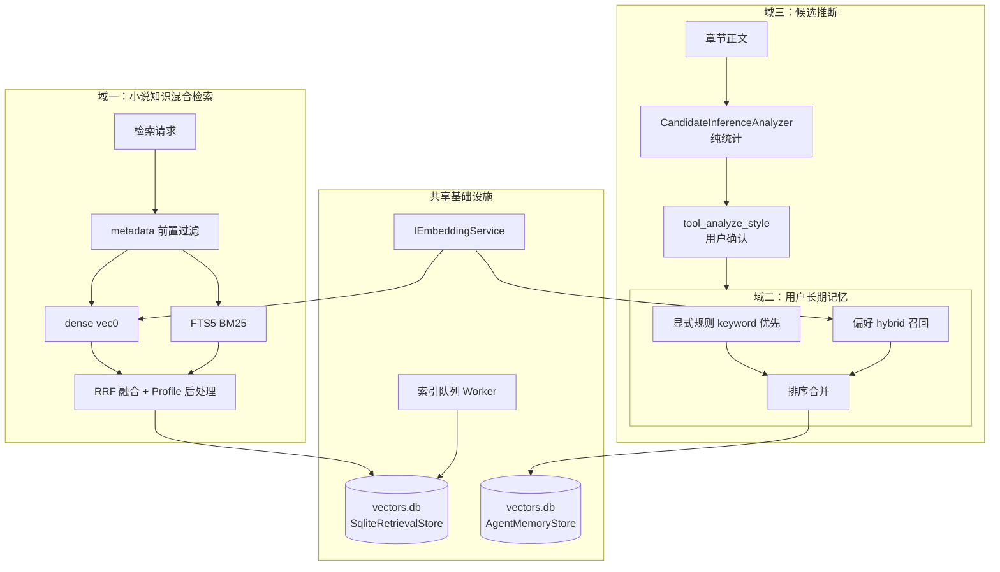

# 本地检索子系统设计（VEC）

> 状态：**与代码同步**（2026-08-30 校准）。本文是本地检索子系统的**唯一规范文档**，文件名 `docs/vec.md`。
> 2026-07 由旧 `vec.md` 合并而来：架构理论（目标、决策、分块理论、混合检索原理、记忆域规则、迁移史）
> 已并入本文（曾用名 VEC-LOCAL.md，现已改回 vec.md）。
> 缺口清单见第 6 章；架构决议见 §0.4；反模式红线见第 7 章。

## 0. 总纲与职责边界

### 0.1 三职责总纲

| # | 职责 | 输入 | 输出 | 依赖模型/云端？ |
|---|---|---|---|---|
| 1 | 小说知识快速混合检索 | 自然语言查询 + metadata 过滤条件 | 带来源、定位、命中通道的结果列表 | embedding 模型（可降级）；可选本地判定（System One，可关闭）；不依赖云端分析 |
| 2 | 用户长期记忆存储与召回 | 记忆写入/查询/管理操作 | 显式规则优先的召回结果 + 可审计历史 | embedding（hybrid 模式，可降级 keyword） |
| 3 | 轻量统计模式识别（候选推断） | 最近章节正文 | 候选风格推断（文本+置信度+证据） | **不需要任何模型，不依赖云端** |

**明确不做的事**（属于云端 云端私有引擎）：专业写作诊断、
情节结构/伏笔/人物弧光分析、题材权重评分。本地通过
`IFictionHarnessClient`（capability `fiction.story.check`）调用云端，不在本设计范围内。
私有权重参数在云端 `Profiles/WritingProfileData`（CHANGE_07 迁出）。

### 0.2 不可破坏的边界（原 vec.md §1.3）

- YAML、Markdown 与 `INovelStore` 是小说事实的唯一权威来源；向量/FTS/元数据均为**可重建派生数据**。
- 用户显式记忆、推断记忆、小说事实不得混淆。用户规则不能被“相似的章节文本”覆盖。
- 检索不得跨用户、跨小说泄露数据；无明确授权默认不跨小说。
- 向量分数不是事实置信度，更不能替代实体一致性校验。
- 索引失败必须可观测、可重试、可修复；**禁止**静默写入随机向量或零向量。
- 本方案不引入实体关系表；关联检索先读实体现有 ID 引用再排序。

### 0.3 已作架构决策（原 vec.md §1.2）

| 决策 | 结论 |
|---|---|
| 面向后续逻辑演进 | 可演进但克制：只定义 Domain/DocumentKind/ChunkPolicy/Metadata/RankingProfile/IndexBuilder 六个稳定概念，不为尚不存在的插件发明通用框架 |
| 混合检索 | 主路径，非可选优化 |
| 分块索引 | ~300 字语义块，保留定位与父章节关系 |
| 实时索引 | 事件驱动异步队列；启动对账只承担补偿与重建 |
| metadata 过滤 | 一等能力，前置收口候选集 |
| 关系表 | 不需要，关联在应用层从事实源构建 |
| 数据模型反向依赖 | 禁止 `IIndexable` 反射自动化；每实体显式声明构建策略 |

### 0.4 最终架构决议（原 vec.md §17）

1. 检索子系统升级为共享内核；逻辑上严格分为**用户长期记忆**与**小说实体知识**两个域。
2. 小说知识域必须全文 ~300 字语义分块，保留父章节/offset/序号/版本，服务暗线检索。
3. 混合检索为默认：metadata/权限过滤先行 → dense vec0 与 FTS 并行召回 → RRF 融合 → 按任务 profile 重排去重。
4. metadata 过滤是核心契约：关键字段候选生成前约束，不得靠结果后过滤兜底。

---

## 1. 总体架构



双重逻辑域共用同一检索内核（embedding/分块/FTS/metadata/融合/重建），
这样第三个域（research_library 等）接入时只新增域名与构建器，不复制检索能力。

关键文件：

```text
src/Core/Vector/
├── IRetrievalStore.cs          域一存储契约
├── SqliteRetrievalStore.cs     域一 SQLite 实现（vec0 + FTS5）
├── InMemoryRetrievalStore.cs   域一内存降级实现
├── RetrievalKernel.cs          门面：搜索/索引/队列/记忆协调
├── ChineseTextChunker.cs       300 字语义分块
├── DocumentBuilder.cs          实体 → 检索文档
├── RankingConfig.cs            四种排序 Profile
├── RetrievalPostProcessor.cs   融合后处理（去重/多样性/章节归并）
├── AgentMemoryStore.cs         域二存储（TACOS 日志 + 时间旅行）
├── AgentMemoryVec.cs           域二 ANN 候选表同步（agent_memory_vec vec0）
├── AgentMemoryBm25/Scoring/Packing/Conflict.cs   域二算法组件
└── CandidateInferenceAnalyzer.cs                 域三统计识别器

src/Core/Inference/           本地判定层（可选，§2.8）
├── SystemOneModels.cs          线协议模型 + 容错解析（noul / choice）
├── SystemOneClient.cs          /v1/systemone 客户端（本地 d1-omni 或托管 Jev：base-url/path/api-key）
└── SystemOnePacking.cs         字符预算批打包
```

---

## 2. 域一：小说知识快速混合检索

### 2.1 数据模型：三层派生结构（原 vec.md §4.1）

物理同库 `vectors.db`，逻辑三层：

| 层 | 表 | 职责 |
|---|---|---|
| 文档层 | `retrieval_documents` | 来源身份、域、作用域、实体归属、版本、内容哈希、索引状态 |
| 块层 | `retrieval_chunks` | 可引用文本单元；字符区间、序号、块类型、父级定位、chunk hash |
| 索引层 | `vec_chunks`（vec0）+ `retrieval_chunks_fts`（fts5） | 同一块 dense 向量 + 词法索引；FTS 列存 jieba 预分词的 `tokens`（空格连接），不依赖 simple 原生扩展；可重建 |

### 2.2 稳定字段（原 vec.md §4.2，唯一权威契约）

| 字段 | 约束 |
|---|---|
| `document_id` | 稳定业务键，**禁用运行时字符串哈希**；同域/作用域/种类/来源 → 同一 ID |
| `chunk_id` | `document_id + ordinal + 版本/内容哈希`；不得只用数组下标 |
| `domain` | 必填；`user_memory` / `novel_knowledge`；查询必须显式指定 |
| `owner_id` | 用户隔离；用户记忆必有，小说域保留项目归属 |
| `novel-id` | 小说知识必有；全局用户记忆为空 |
| `document_kind` | `character_profile` / `chapter_body_chunk` / `scene_definition` / `user_rule` … |
| `source_entity_type` / `source_entity_id` | 回到事实源 |
| `source_revision` | 事实源版本（`UpdatedAt` 或等价单调版本），仅辅助 |
| `content_hash` | 去重与增量判断；模型变更时不能跳过重 embedding |
| `embedding_model_id` / `embedding_dimension` | 向量空间隔离；不一致禁止混搜；`embedding_model_id` 参与启动对账，模型变更触发该小说知识域重建 |
| `lexical_version` | **已上移到 `retrieval_fts_partitions`（小说级）**：实体词典名称集合哈希 + 策略前缀；变化时只重建该小说 FTS 分区的 tokens，不重算 embedding |
| `index_status` | `pending/ready/failed/stale/deleted`；failed 不得参与召回 |
| `created-at` / `indexed_at` | 审计；不替代实体修改时间 |

### 2.3 metadata schema（原 vec.md §4.3/§4.4）

**原则**：高频强过滤字段入规范化列/辅助索引，不进 JSON 后过滤；低频/展示字段保留 JSON。
所有 metadata key 受控字典，禁止 `chapterId`/`chapter_id`/`sourceChapter` 混写。
字段类型不符、key 未知必须显式报错，不得静默忽略后扩大召回。

小说知识域共同字段：

| 字段 | 类型 | 用途 |
|---|---|---|
| `chapter_order` / `chapter_id` | int / ID | 范围过滤、精确限定、结果聚合 |
| `entity_status` | 枚举 | 排除失效/归档/草稿 |
| `tags` | 集合 | 受控标签 |
| `scene-type`、`participant-ids`、`plotline_ids`、`location_id` | 集合/ID | 场景按角色/情节线/地点过滤 |
| `time-description` | 文本 | 展示与词法命中，不作可靠时间线排序 |
| `source_offset_start/end`、`chunk_ordinal` | int | 原文精确定位、相邻块扩展 |

用户长期记忆域共同字段：`memory_kind`、`scope`、`source_kind`
（explicit/confirmed_inference/system_default，未确认推断不注入）、`confidence`、
`priority`、`expires_at`、`evidence_refs`（引用集合，不存整篇敏感会话）。

### 2.4 分块策略（原 vec.md §6）

| 参数 | 值 | 说明 |
|---|---|---|
| TargetLength | 300 字符 | 目标长度；可接受区间 220–380，非机械截断 |
| OverlapLength | 50 字符 | 相邻块上下文重叠 40–60 |
| 边界优先级 | 小标题 > 场景分隔 > 空行段落 > 句末标点 | 绝不在引号/句中切断 |
| 超长段 | 按完整句子切分；无句界才保底，标 `boundary_quality=forced` | 可观测 |
| 极短段 | 相邻合并，不跨场景/时间跳转 | |
| 文本规范化 | 只做可逆最小规范化，保留原始 offset | 禁止为 embedding 改写正文 |
| 定位 | 每块含章节 ID、ordinal、起止 offset、相邻块 ID | 支持展开前后文 |

**结果归并（§6.3）**：候选允许相邻块重复以防漏检；融合后按父章节与空间邻近归并；
若相邻块都高分返回一个主块及其前后可展开范围；暗线任务启用更高 chunk 多样性与章节覆盖约束，
避免一个章节霸占结果。返回值含章节标题/序号/原文区间/父章节 ID。

**章节编辑重建（§6.4）**：以整章正文为一个索引文档单元。内容哈希未变 → 跳过；
变化 → 该章全部块整体原子重建替换。不要按字符偏移局部修补。原块替换完成前可标 stale，
查询可读旧块并标注版本，或等待替换。默认一致性与正确性优先于毫秒级实时。

### 2.5 实体索引内容策略（原 vec.md §10）

检索文本不是序列化 dump：用可读标签建立语义（“角色”“动机”“弱点”），
名称/别名/标题等专名同时提供 FTS 友好字段；不把未经验证的 AI 推断写入事实索引。
特别关键的实体：

- **Character**：补齐 Tags、Abilities、Weakness、Habits、Status、组织名称/ID（人物习惯是一致性关键事实）。
- **SceneDefinition**：冲突、目标、情绪弧、时间、场景类型、地点名称、角色名称、情节线名称、Notes。
- **Chapter**：`chapter_summary` 与 `chapter_body_chunk` 双路径；摘要来自可靠结构化来源，禁止 LLM 幻觉摘要当权威。
- **TimelineEvent / Relationship**：索引可读陈述 + metadata 关联 ID；一致性工具最终回读事实源验证。

### 2.6 写入管线与索引状态机

```text
FileNovelStore.OnEntityChanged
  → TuiApp.OnStoreEntityChanged (src/Tui/TuiApp.Indexing.cs)
  → RetrievalKernel.EnqueueIndexTask        ← 同实体去重：只保留最新任务
  → WorkerLoop（MaxConcurrency=2）
  → IndexTask.BuildFunc → DocumentBuilder → ChineseTextChunker
  → IndexDocumentAsync：批量 embedding（IBatchEmbeddingService）
      ├─ 批量失败 → 回退逐条
      └─ 零向量 → 该块保持 pending，文档标 failed
  → store.UpsertDocumentAsync（原子：旧块 stale → 新块写入）
```

状态机：

| 状态 | 含义 | 召回行为 |
|---|---|---|
| `pending` | 已写入，embedding 未就绪 | 不返回 |
| `ready` | dense + lexical 同版本可用 | 正常返回 |
| `stale` | 事实源已更新，旧块待替换 | 默认排除 |
| `failed` | embedding 失败/零向量/维度不符 | 不返回，等待重试 |
| `deleted` | 事实源已删除 | 永不返回；`PurgeDeletedAsync` 物理清理 |

红线：零向量、维度不匹配、Dummy embedder 用于生产索引 → 一律 `failed`，不得伪装 ready。

**模型切换与索引版本（§9.4）**：索引记录必须含 embedding 模型 ID、维度、schema 版本、
chunk policy 版本、text builder 版本。发生不兼容变更：标记受影响版本 stale → 小说知识全量重建
→ 用户记忆保留原始文本重 embed（不丢用户规则）→ 重建完成前查询只能用同版本候选，禁止新旧混合。

### 2.7 查询管线与降级链

```text
RetrievalKernel.SearchAsync(request)
  1. EmbedAsync(query) → 零向量？
       ├─ 是 → 降级纯词法（DenseTopK=0），LogWarning，不中断
       └─ 否 ↓
  2. store.SearchAsync：
       a. metadata 前置过滤 → 合法 chunk_id 候选集（权限/作用域在此收口）
       b. DenseSearchAsync（vec0，候选集内 topK）
       c. LexicalSearchAsync（FTS5 BM25，候选集内 topK）——两路并行
       d. RRF 融合（按 chunk_id 去重，双通道贡献叠加）
  3. RetrievalPostProcessor.Process(results, RankingConfig.ForProfile(profile))
```

**过滤语义（原 vec.md §8.2）**：
- 多条件默认 AND；同字段多允许值默认 OR。
- ID 集合 `contains`：空集合不得匹配全部。
- `chapter_order`/数值/时间用类型化比较，禁止字符串词法比较。
- 不支持的 filter key、类型不符、跨域字段必须失败并给出可读错误，不得 silently ignore。
- metadata 过滤用于候选集约束；轻量后处理可做展示归并，但不能替代前置过滤。

**降级链总表**：零向量查询 → 纯词法；批量 embedding 失败 → 逐条；sqlite 初始化失败 →
InMemoryRetrievalStore。词法层始终使用 jieba 预分词后的 `tokens` 列；`simple` 原生扩展缺失只记日志，
不再决定 FTS 分词质量。

**FTS 按小说分区**：每部小说一对对象——视图 `chunks_p_<suffix>`（该小说块的 `rowid/chunk_id/tokens`）
与 external-content 的 `fts_p_<suffix>`（`content=` 指向该视图），元数据在 `retrieval_fts_partitions`
（表名/块数/`lexical_version`/重建时间）；`novel_id` 为空的文档（会话历史等）落默认分区。
分区隔离的原因：FTS5 的 BM25 统计是全索引级的，共用一张表时别的书的高频词会把本书词项分数打到 0
（实测同一词 6.995 → 0.000）；`rebuild` 也因此只随该小说块数增长，而不是全库。

**词典与发射模式**：实体名（角色/组织/地点/道具/情节线/场景）全部 `AddWord`（去空格、按标点分段、freq=1e5；
2 字名的最大概率路径阈值可达数千，freq=10 会输）；书名/卷名/章名不注册（描述性短语，注册反而掉召回，
且标题已有 ChapterSummary/NovelProfile 独立文档承担排序）。索引侧用 `CutForSearch` 发「长词 + 已知子词」，
查询侧 AND 只取最佳路径、OR 含子词。词典是**进程全局**的（JiebaNet 词表为单例），版本按全局名字集合算。
实时实体变更（TUI `EnqueueIndexTaskAsync`）改词典后只调 `RetokenizeNovelAsync`：按该小说重算 tokens +
分区 `rebuild`，**不重嵌入**；per-novel 单飞 + dirty 合并，连续改名最多重跑一次。
一致性 profile 用 AND（精确），暗线/写作 profile 用 OR（召回）。
实时索引（事件通道）与启动对账（补偿通道）双通道，崩溃/离线/队列失败由对账兜底。

### 2.8 排序 Profile 与重排信号（原 vec.md §7.3）

| Profile | 取向 | 典型调用方 |
|---|---|---|
| `WriteContext` | 当前章节附近场景、相关人物 | 写作上下文注入 |
| `ConsistencyCheck` | 角色事实、时间线、精确名称，lexical 权重高 | find_consistency |
| `ForeshadowingSearch` | 高 dense 权重 + 多样性 + 跨章节覆盖 | recall_plot 暗线查询 |
| `PreferenceRecall` | 显式规则先行 | 用户记忆召回 |

可后续加入的重排信号：显式规则优先级（高，压过相似度）、source/confidence（推断不得压过显式）、
章节距离（附近加权但不遮蔽关键旧伏笔）、实体精确命中、chunk 去重、多样性（暗线/探索查询）、
新近性（仅候选推断；小说事实由实体版本而非时间偏好决定）。每个 profile 集中定义并记录版本，
禁止各工具私自复制融合公式。

**本地判定重排（可选，已实现）**：`JudgeRerank` 在 RRF 融合后、后处理前逐条问 System One
`noul`（"段落 pNN 是否应作为该检索意图的上下文素材"），按 `score × (1 + w·(2p−1))`（w 默认 0.5）
重排：**只重排不丢弃**；缺答案/请求失败保持原分（失败是未知，绝不构成负判），首个请求失败整体跳过；
`UserMemory` 域永不参与（显式规则遗漏率必须为 0）。开关 `system-one.enabled` +
`system-one.rerank.enabled`；候选先放大 `rerank.overfetch`（上限 50）再回落 `FinalTopK`。

### 2.9 对账与删除

- **补偿对账**：启动时 `VectorSyncService` 遍历小说，用 `GetIndexedDocumentIdsAsync`
  对比事实源，补齐漏索引、清理已删除实体索引。不替代实时通道，只兜底。
- **删除**：事件驱动 `MarkDocumentDeletedAsync`（立即不可见）→ 后台 `PurgeDeletedAsync`
  物理清理 vec0/FTS。不允许只删一种索引留下幽灵召回。

### 2.10 工具消费面（现状）

| 工具 | 插件 | 检索策略 |
|---|---|---|
| `search_memory` | SemanticRetrievalTool | 广义 hybrid，多种类 + metadata 过滤 |
| `recall_character` | SemanticRetrievalTool | 角色精确过滤 + hybrid |
| `recall_plot` | SemanticRetrievalTool | plotline 过滤 + chapter chunk hybrid + 多样性 |
| `find_consistency` | SemanticRetrievalTool | ConsistencyCheck profile |
| `batch_search_memory` | SemanticRetrievalTool | 批量查询共享一次过滤编译 |
| `recall_scene` | SemanticRetrievalTool | 场景 metadata 过滤（角色/情节线/地点/类型/章节）+ hybrid；空查询走事实源枚举 |
| `recall_timeline` | SemanticRetrievalTool | 章节范围过滤 + 词法优先（ConsistencyCheck profile）；角色名确定性词法过滤 |
| `recall_related` | SemanticRetrievalTool | `IPluginStore` 精确关联（关系/参与场景/成员组织）+ hybrid；不建关系表 |
| `recall_preference` | Core | §3.4 策略：规则 keyword/全量 + 偏好 hybrid + 候选推断隔离 |
| `save_preference` | Core | 显式偏好保存，强制 scope（global/novel）+ 确认语义（explicit/confirmed） |
| `list_preferences` | Core | 可靠枚举（ID/scope/kind 标注），候选推断排除 |
| `delete_preference` | Core | ID 精确删除（支持短 ID），撤销后立即不再注入 |
| `find_similar_character` / `find_location_by_description` | NovelTools | 已迁移至内核（旧栈降级关键词路径已删除） |
| `scan_relationships` | NovelTools | 全实体提及（角色/组织/地点/道具/情节线/场景，最长优先 + 占用区间）→ 同句封锁 + 本体域/值域门 → 本地判定该类型对允许的关系（+ none/uncertain）→ 确定性证据闸门（状态 + 原因码）→ 回执；只提案不写库（确认后经 `manage_relationship`） |

返回契约：来源类型与实体 ID、作用域、chunk 定位（章节/序号/offset）、
命中通道（dense/lexical/exact_filter/融合）、分数、metadata 摘要、boundary_quality。

### 2.11 性能与观测点

预算由真实数据决定（§8.2）。观测点：

```text
FilterCandidatesAsync 候选数 / 耗时
DenseSearchAsync / LexicalSearchAsync 各自延迟
RRF 融合与后处理耗时
embedding 单条 / 批量延迟（含失败率、零向量次数）
索引队列深度（PendingTaskCount）、单任务处理时长
```

已知实现注意项（改动前先测量）：`DeleteEntityAsync` 按 DocumentKind 枚举逐个点查（N 次）；
`EnqueueIndexTask` 去重重建整个队列（O(n)，n=队列深度，通常极小）。

---

## 3. 域二：用户长期记忆

### 3.1 信任层级（原 vec.md §5.1.1）

| 层级 | 是否自动写入 | 是否注入 prompt | 示例 |
|---|---|---|---|
| 显式不可违背规则 | 用户明确或确认 | 是，最高 | “不要用文言文” |
| 显式偏好 | 用户明确 | 是 | “偏好短句” |
| 经确认的推断 | 系统提出 + 用户确认 | 是（低于显式） | “你常压缩长段环境描写” |
| 候选推断 | 自动分析未确认 | **否** | “可能偏好破折号” |

禁止把单次编辑、临时指令、模型猜测或未确认画像直接升级为长期记忆。

`AgentMemoryKind`（**工具参数与枚举的唯一权威映射**，历史描述缺陷已修复）：

| 值 | 枚举 | 可注入 |
|---|---|---|
| 0 | `Explicit` | 是（最高优先级） |
| 1 | `ConfirmedInference` | 是（低于显式） |
| 2 | `CandidateInference` | **否（内核强制过滤）** |
| 3 | `NarrativeContract` | Phase 3 启用 |
| 4 | `CollaborativePattern` | Phase 3 启用 |

命名空间：`ns="rule"` 规则，`ns="default"` 偏好。作用域 `AgentMemoryScope`：
Global / PerNovel / PerSession。

### 3.2 作用域与覆盖 + owner 前置（原 vec.md §5.1.2/§5.1.3）

1. `global_user`：标点、格式、协作方式等跨项目稳定规则。
2. `novel_override`：只对某部小说有效的语气、禁用词、叙事视角、类型约束。
3. 当前会话临时指令：不写入长期记忆。

冲突顺序固定：**当前用户明确指令 > 当前小说显式规则 > 用户全局显式规则 > 已确认推断 > 系统默认**。
同级矛盾以更晚更新且用户更明确确认的记录为准，并在记忆管理界面/工具中显示冲突。

owner 前置：单机单用户现用 `OwnerId="local"`；多用户/云同步前必须先落稳定本地 profile UUID
（`~/.mythology` 维护，不用机器名/路径/空串）。无可靠 owner 时禁用长期记忆读写，不得退化为匿名共享。

### 3.3 记录模型（MemoryRecord）

关键字段：`OwnerId`、`NovelId`（null=全局）、`Namespace`、`Content`、`Importance`、
`MemoryKind`、`Confidence`、`Priority`、`ExpiresAt`（`IsExpired(now)`）、`Usefulness`、
`AccessCount`、`LastAccessedAt`、`EvidenceRefsJson`（推断类必填证据链）。

### 3.4 召回与注入策略（RetrievalKernel.SearchUserMemoryAsync）

```text
输入：ownerId, novelId, query?, topK
① 显式规则（ns=rule）：
     有 query → RecallAsync(mode=keyword) 精确匹配
     无 query → GetAllAsync 全量载入（硬规则不因相似度丢失）
     priorityBonus = 2000
② 偏好（ns=default）：RecallAsync(mode=hybrid)
     过滤 MemoryKind == CandidateInference（强制）
     priorityBonus = 500
③ 按最终分数降序取 topK
```

行数 ≥2000（AnnMinRows，internal 可调）且 vec0 可用时，向量通道先经 `agent_memory_vec` ANN 取 top-max(500,10k) 候选再精确重评；
BM25 与规则通道恒全量，显式规则遗漏率不受影响（非候选行 vs=0，是唯一有界近似）。

确定性优先于语义相似度：规则走 keyword/全量，绝不被低向量分挤掉；偏好才用 hybrid。
`AgentMemoryHook` 在记忆被引用后自动 `mark_useful`，`Usefulness` 参与后续排序，形成反馈闭环。

### 3.5 存储：TACOS 日志 + 时间旅行

| 能力 | API | 用途 |
|---|---|---|
| 快照 | `SnapshotAsync(label)` | 命名时间点 |
| 时点读取 | `AsOfAsync(label/time)` | “当时记得什么” |
| 差异 | `DiffAsync(a, b)` | 两快照间变化 |
| 日志 | `GetJournalAsync()` | 全部变更流水 |
| 打包 | `PackAsync(query)` | 按任务打包相关记忆 |
| 合并 | `ConsolidateAsync()` | 近重复清理 |

用户可审查、可回溯、可撤销——记忆不是黑箱。

### 3.6 目标工具族（原 vec.md §11.1）

**目标形态（工具面向用户任务，不让 Agent 猜 vec0 表结构）：**

| 工具 | 域 | 任务 | 策略 |
|---|---|---|---|
| `search_memory` | 小说知识 | 广义检索 | hybrid，多种类 + 过滤 |
| `recall_character` | 小说知识 | 人物设定与证据 | 角色过滤 + hybrid |
| `recall_scene` | 小说知识 | 场景计划 | scene metadata + hybrid |
| `recall_plot` | 小说知识 | 情节线/伏笔/回收 | plotline + chunk hybrid + 多样性 |
| `recall_timeline` | 小说知识 | 事件一致性 | 范围/角色过滤 + lexical 优先 |
| `recall_related` | 小说知识 | 给定实体相关内容 | `INovelStore` 精确关联 + hybrid；不建关系表 |
| `recall_preference` | 用户记忆 | 当前任务偏好 | 显式规则 + 偏好 hybrid |
| `save_preference` | 用户记忆 | 保存显式偏好 | 必须指定 scope/来源/确认语义 |
| `list_preferences` / `delete_preference` | 用户记忆 | 审阅/纠错/撤销 | 可靠枚举 + ID 删除，不只按语义搜索 |
| `scan_relationships` | 小说知识 | 关系提案 | 全实体提及 + 同句封锁 + 本体域/值域门 + System One 闭集 Choice + 双阈值证据闸门（概率/置信度，带原因码与回执）；只提案，确认后写事实 |

**当前已实现 18 个工具**（全部 DeferLoading 按 tool_search 发现）：

```text
写入/更新   tool_store · reinforce · forget · mark_useful · mark_useless
召回        recall（keyword/vector/hybrid）· pack
一致性      find_conflicts · resolve_conflict
时间旅行    snapshot · as_of · diff
维护        stats · consolidate
候选推断    analyze_style（域三入口，见第 4 章）
任务导向    recall_preference · save_preference · list_preferences · delete_preference（§3.6 用户记忆域）
```

错误语义统一：参数缺失/无小说/不存在 → `IsError=true` 可读文本，不抛异常打断 Loop。

### 3.7 生命周期与衰减红线（原 vec.md §5.1.5）

- 强化：`ReinforceAsync` 提升 Importance；有用性反馈走 mark_useful/useless。
- 过期：`ExpiresAt` 到期即 `IsExpired`，召回层排除；显式规则默认不过期。
- 冲突：`FindConflictsAsync` → `ResolveConflictAsync(keepIds, deleteIds)` 用户裁决。
- 冲突预判（可选）：`system-one.conflicts.enabled` 时 `AgentMemoryConflict.AdjudicateAsync` 对启发式冲突做四分类
  （contradiction / refinement / duplicate / unrelated）：高置信 `unrelated`（p ≥ `drop-unrelated-probability`）
  从结果中移除，其余按 contradiction 优先重排并回填 `JudgeVerdict/JudgeProbability`；
  判定失败 fail-open（原样返回启发式结果，绝不因失败丢弃冲突）。
- **衰减只影响候选推断资格，绝不静默修改用户显式内容**；保持最小审计信息。

---

## 4. 域三：轻量统计模式识别（CandidateInferenceAnalyzer）

### 4.1 定位

纯文本统计，无模型调用、无网络依赖、毫秒级完成。**不判断写作好坏**
（那是云端 23 个专业分析器的事），只发现“作者稳定重复的行为模式”。

### 4.2 四维度阈值表

| 维度 | 判定 | 阈值 |
|---|---|---|
| 段落长度 | 短段 / 长段 | 章内平均 ≤100 / ≥500 字符 |
| 句长分布 | 短句 / 长句 | 平均 ≤30 / ≥80 字符 |
| 标点密度 | 省略号 / 破折号偏好 | ≥3 / ≥2 处每千字 |
| 改写痕迹 | 段落长度不一致 | 标准差/均值 ≥0.8 |

通用门槛：句末标点集 `。！？\n；`；省略号 `……`、破折号 `——`（成对计数）；
空内容章节剔除；按 Order 排序；**至少 3 章一致观察**（MinObservations）才产生候选。

### 4.3 置信度模型

```text
confidence = min(0.3 + 0.1 × observationCount, 0.6)
```

候选推断置信度**硬上限 0.6**——未确认的推断不能逼近显式规则的 1.0。
每次分析输出：稳定 ID、推断文本、置信度、证据描述、观察次数、首末观察时间。

### 4.4 确认工作流（唯一合法路径）

```text
用户/Agent 发起 tool_analyze_style（最近 3~30 章，默认 10）
  → 分析器产出候选列表（含证据）
  → Agent 逐条展示给用户
  → 用户确认 → tool_store(memoryKind=1 ConfirmedInference, confidence≤0.6→可提升)
  → 用户拒绝 → 不保存（或保存为 CandidateInference 仅留档）
全程候选不进入 prompt 注入（内核在 SearchUserMemoryAsync 强制过滤 kind=2）
```

安全红线（违反即 bug）：① 候选推断自动注入 prompt 次数必须为 0；
② 确认必须来自用户明示动作，不得以“多次出现”自动升级；
③ 撤销（forget）后立即不再注入，证据链保留最小审计信息。

### 4.5 扩展规范

新增维度必须满足：可解释（能说清基于什么观察）、低风险（错了不影响事实正确性）、
可统计（纯文本可计算）、有明确阈值与最少观察数。需要语义理解的“风格分析”
一律走云端，不得在本分析器里加模型调用。

---

## 5. 共享基础设施

### 5.1 DI 装配与降级矩阵（CoreServiceExtensions.AddMythologyCore）

| 组件 | 首选 | 降级 | 触发条件 |
|---|---|---|---|
| 检索存储 | SqliteRetrievalStore | InMemoryRetrievalStore | sqlite-vec 初始化失败 |
| FTS 分词 | 每部小说独立 jieba 用户词典 + 预分词 tokens（空格连接，unicode61 索引） | 旧库迁移时自动回填 tokens 并重建 FTS | 无（不再依赖 simple 原生扩展） |
| Embedding | 云端 `CloudEmbeddingClient`（/v1/embedding，显式 opt-in：config.yaml `Embedding.Provider: cloud`）→ `EmbeddingService`（LlmTornado，复用聊天 Provider 或 config.yaml 独立 embedding 密钥） | `DummyEmbeddingService` | provider≠cloud 且未配置 embedding 模型名（显式 opt-in，不发远程请求） |
| 记忆存储 | AgentMemoryStore（sqlite） | 不注册（kernel.AgentMemory=null） | 初始化失败 |
| 本地判定（System One） | `SystemOneClient`（llama.cpp `/v1/systemone` 或托管 Jev） | 判定路径全部短路（零请求） | `system-one.enabled=false`、请求失败/超时 |

冷重配置：`RetrievalKernel.UpdateEmbeddingService` 仅在 Loop 停止时由设置界面调用；
维度一致即时替换，不一致拒绝并要求重启重建（防止混搜不同向量空间）。

### 5.2 Embedding 服务契约

`IEmbeddingService.EmbedAsync(text, ct)`；批量实现另实现 `IBatchEmbeddingService`。
实现方义务：失败**不得返回零向量假装成功**（零向量 = failed 信号）；`Dimension` 供维度校验。
查询侧零向量触发纯词法降级；索引侧零向量标 failed。

### 5.3 文件布局与可重建性

```text
~/.mythology/
└── vectors.db      域一：retrieval_documents/chunks + vec0 + fts5（可全量重建）
                    域二：agent_memories / agent_journal / agent_snapshots + agent_memory_vec
                    （记忆原始文本是用户数据，只许重算 embedding，不许丢记录；
                      ANN 候选表可重建）——两域共享同一物理库，逻辑域由 domain 列区分
```

> 向量维度固定 `VectorDefaults.Dimension = 1024`（`CoreServiceExtensions.RegisterRetrievalAsync`
> 不做启动探测——探测是启动链路上的远程调用，远端不可达会拖住入口；维度不一致在真实索引时显式失败）。
> 云端 `CloudEmbeddingClient`（/v1/embedding 消费方，TUI 与 Desktop 均支持）为**显式 opt-in**：
> config.yaml `Embedding.Provider: cloud` 时启用（未登录/服务端未配置时首次调用显式失败，
> **不静默退零向量**）；**云端 `Cloud:VectorDimension` 必须同为 1024**，否则首次索引/检索显式报错并给出调整指引。

### 5.4 迁移与重建史（原 vec.md §12，已完成）

旧 `IVectorStore` 栈（InMemoryVectorStore/SqliteVectorStore/VectorIndexer/VectorSearchEngine/MinHeap）
在该内核通过验收、所有工具切换后 clean cutover 删除（对应原 §12.2/§15 “长期维护两套检索接口”反模式）。
保留 `AgentMemoryKind.CandidateInference` 等枚举——仍被记忆存储与工具语义使用。
清理由 `Migration_015` + DI 清理完成，历史曲线见 git 历史。

---

## 6. 实施状态对照与缺口

### 已实现（有测试覆盖）

- [x] 三层 schema + vec0/FTS5 双通道 + RRF 融合 + metadata 前置过滤
- [x] 300 字语义分块（重叠 50，边界质量标记）
- [x] 事件驱动实时索引（同实体去重，并发 2）+ 启动对账（VectorSyncService）
- [x] 五态索引状态机 + 零向量/批量失败降级链
- [x] 四种排序 Profile + 后处理（去重/多样性/章节归并）
- [x] 记忆 14 工具 + TACOS 时间旅行 + 冲突检测裁决
- [x] 规则 keyword 优先 / 偏好 hybrid / 候选推断强制隔离
- [x] 候选推断四维度分析器 + tool_analyze_style 确认工作流
- [x] 内存降级实现 + jieba 预分词 FTS（不再依赖 simple 扩展）
- [x] 本地判定层（可选）：System One 客户端（/v1/systemone；本地 d1-omni 或托管 Jev）+ 检索重排 + 冲突预判 + 关系提案扫描

### 缺口（按优先级）

| P | 缺口 | 说明 |
|---|---|---|
| ~~P1~~ | ~~§3.6 目标工具族不全~~ | ✅ 已补齐（2026-08-22）：`recall_scene` / `recall_timeline` / `recall_related`（RagTools 小说知识域）+ `recall_preference` / `save_preference` / `list_preferences` / `delete_preference`（Core 用户记忆域）；空文本查询走事实源过滤路径（§0.2 事实源为准），角色名过滤用确定性词法匹配不依赖 FTS |
| P2 | owner_id 固定 "local" | 单机可用；多用户/云同步前必须落 §3.2 profile UUID 方案 |
| P2 | 检索质量指标未建立 | Recall@K / MRR / Filter precision / Chunk redundancy / Hybrid uplift / Index freshness / Memory safety 无评测集跑批 |
| P3 | DeleteEntityAsync N 次点查 | 功能正确，量大后再优化为按 novelId+entityId 单查 |
| P3 | 索引队列无持久化 | 进程崩溃丢队列内存任务；启动对账兜底，最终一致 |

### 明确不做

- 本地不做专业写作分析（云端职责）。
- 不恢复旧 IVectorStore 栈（clean cutover 已完成，§5.4）。
- 不引入实体关系图（关联检索从 INovelStore 事实字段构建，§0.2）。

---

## 7. 风险与反模式红线（原 vec.md §15）

| 风险/反模式 | 处置 |
|---|---|
| 将所有聊天记录永久向量化 | 只保存经明确规则筛选的长期记忆 |
| 把候选推断当用户命令 | 候选默认不注入，必须确认 |
| 只把 metadata 塞 JSON | 高频过滤字段必须可前置查询 |
| 只做 dense 或只做 FTS | 混合检索为默认主路径 |
| 固定字符硬切 300 字 | 语义边界优先，长度只是目标 |
| 只索引章节开头/单摘要 | 全文 chunk + 章节摘要双路径 |
| 把向量分数当事实真相 | 重要事实回读 `INovelStore` 验证 |
| 静默吞 embedding 错误 | 明确 failed/stale 状态、重试与观测 |
| 用运行时 hash 做持久化主键 | 使用稳定业务键/数据库映射 |
| 长期维护旧新两套检索接口 | 迁移验证后 clean cutover，删除旧路径 |
| 为将来图查询预建关系表 | 现阶段从 `INovelStore` 真实引用字段做关联 |

---

## 8. 测试与验收

### 8.1 必测行为矩阵（原 vec.md §14.1）

| 类别 | 必测场景 | 现状 |
|---|---|---|
| 分块 | 伏笔在长章后段可召回；不在引号/句中断裂 | ✅ 检索专项测试 |
| hybrid | 专名 lexical 命中；近义 dense 命中；双通道去重 | ✅ |
| metadata | 范围外/未参与场景不出现；空集合不匹配全部 | ✅ |
| 降级 | 零向量→纯词法；sqlite 失败→内存；simple 失败→unicode61 | ✅ |
| 索引 | 连改同章只见最新版；删除无幽灵召回；重启对账恢复 | ✅ |
| 记忆 | 硬规则不因低分漏注入；小说覆盖全局；候选推断注入次数=0 | ✅ |
| 时间旅行 | snapshot/as_of/diff 一致性 | ✅ |
| 候选推断 | <3 章不产出；≥3 章稳定模式产出；确认后才可注入 | ✅（AnalyzeStyleToolTests 等） |
| 性能 | 真实小说规模压测（延迟 p95、队列积压恢复） | ⬜ 待真实数据（§2.11） |

### 8.2 检索质量指标（原 vec.md §14.2）

- **Recall@K**：已标注证据是否进入前 K；追踪暗线、人物设定、专名。
- **MRR / nDCG**：关键证据是否足够靠前。
- **Filter precision**：过滤结果中违反条件的比例必须为 0。
- **Chunk redundancy**：最终结果中同章节高重叠块的比例。
- **Hybrid uplift**：相对 dense-only / lexical-only 的提升。
- **Index freshness**：实体保存到新版本可检索延迟 + 失败任务滞留数。
- **Memory safety**：候选推断被注入 prompt 次数必须为 0；显式规则遗漏率必须为 0。

指标按 `RankingProfile` 分开统计；写作上下文的最佳排序 ≠ 一致性校验的最佳排序。

---

## 变更记录

- **2026-10-18（关系管线升格：全本体 + 证据闸门 + 回执）**：把 `scan_relationships` 从「人名×15 类」
  升成 jevgraph 有界管线的完整形态，本体基于本仓既有词表（不引入第二份关系名词表）：
  - **本体单一事实源** `Core/Data/RelationshipOntology.cs`：15 条 `RelationshipType` 声明
    （token/标签/判据/域-值域/有向）+ 20 条结构性关系（云端图谱关系词汇：
    membership/leadership/headquarters/located-at/belongs-to/appears-in/in-chapter/in-volume/
    advances/features/reveals-at/resolves-at/occurs-in/evolves/contains/adjacent-to/ownership/
    relationship/faction-relationship/constrains）。两条云端通道各自有 token 口径（图边类型 vs
    设定检查 `Relations[].Type`，主仆→master、同门→sect-mate 收敛到本体）；`SetupDigestBuilder`
    的类型/有向映射改为读本体（行为不变）。
  - **提取泛化**：`RelationshipScanPipeline` 目录从「角色」扩到角色/组织/地点/道具/情节线/场景，
    非角色实体同样占区间（「青云宗」挡住「青云」），候选对按本体域/值域门过滤（叙事关系只允许
    角色×角色——本地 `Relationship` 只有角色端点，不假装可写其他类型对）。
  - **证据闸门**（jevgraph builder）：`missing_answer` / `provider_selected_none`(拒) /
    `provider_requested_more_context` / `relation_failed_schema_check` /
    `below_probability_threshold` / `below_confidence_threshold` / `passed_configured_gates`，
    输出逐行状态 + 原因码（无序对去重已在管线内完成，等价于 jevgraph 的对称重复拒绝）。
  - **回执**：每批判定记 `RelationshipScanReceipt`（批次/题数/成败/model/输入输出 tokens/耗时），随
    `RelationshipScanDetails.Receipts` 返回。
  - **配置**：`system-one.relations.min-confidence`（默认 0.8；应答无置信度时不判）。设置界面未暴露该字段
    （可用 config.yaml 调整）。
  - 测试：Core.Tests **1338/1338**（新增 `RelationshipOntologyTests` 6 例）、NovelTools.Tests **133/133**
    （扫描用例升至 14 例：跨类型封锁/非角色占用区间/原因码/回执）、Host **212/212**、Desktop **288/288**。
- **2026-10-18**：新增本地判定层（可选，config `system-one.*`，关闭时零请求）：
  `src/Core/Inference/`（SystemOneClient/Packing/Models，含 base-url/path/api-key，可指向本地 d1-omni 或托管 Jev）；
  `JudgeRerank` 在 RRF 后做 noul 判定重排（只重排不丢弃，UserMemory 域除外）；`AgentMemoryConflict.AdjudicateAsync`
  四分类冲突预判（高置信 unrelated 移除，失败 fail-open）；新工具 `scan_relationships`（jevgraph 提炼：
  提及→同句封锁→15 类 Choice→确定性闸门，不写库）。TUI/Desktop「嵌入」页底部新增「本地判定 · 可选」区块，
  保存即热生效（`RetrievalKernel.SystemOne.UpdateConfig`）。
- **2026-08-23**：域二接入 vec0 ANN 两阶段（`agent_memory_vec` 表）：行数 ≥2000 时向量通道先 ANN 取候选再精确点积重评；
  BM25/规则通道恒全量；扩展加载失败静默退化全量精确（零行为变化）。修复 corpus 缓存写入失效缺陷
  （Store/Forget/Resolve/Consolidate 现清 `_corpusCache`，embedding 服务重配同样失效）与 RecallAsync 热路径
  无条件读全部 BLOB 的缺陷。新增 `AgentMemoryVec.cs` + 6 个测试（ANN parity 60ms vs 50ms @600 条）。
- **2026-08-22**：补齐 §3.6 P1 目标工具族（7 个任务导向工具）：
  小说知识域（SemanticRetrievalTool）新增 `recall_scene`/`recall_timeline`/`recall_related`，空文本查询走事实源过滤（§0.2），
  角色名过滤用确定性词法匹配不依赖 FTS；用户记忆域（Core）新增
  `recall_preference`/`save_preference`/`list_preferences`/`delete_preference`，
  `save_preference` 强制 scope+确认语义，`recall_preference` 显式规则永不因相似度丢失
  （keyword 命中 ∪ 全量规则，§8.1 显式规则遗漏率=0）。
  同步补齐 `InMemoryRetrievalStore` 结构化 metadata 前置过滤（participant/plotline/location/scene-type/chapter_order，
  与 SqliteRetrievalStore 语义一致，修复 JsonElement 标量提取），消除降级路径过滤失效。
  测试：SemanticRetrievalTool 36/36、Core 932 通过（1 个既有 AtomicFile 平台换行失败）。
- **2026-07-26**：vec.md 完成（Phase 0–4 实现，603 项测试）。
- **后续**：新增 `CandidateInferenceAnalyzer` 接线为第 14 个记忆工具 `tool_analyze_style`；
  修复 `tool_store` 记忆类型参数描述与 `AgentMemoryKind` 枚举不一致的缺陷
  （旧文误写 `1=Inferred,3=ConfirmedInference`，实际 `1=ConfirmedInference,2=CandidateInference,3=NarrativeContract`）。
- **2026-07（合并）**：旧 `vec.md` 合并入本文，成为唯一规范文档（曾用名 `VEC-LOCAL.md`）。
- **2026-08-30（校准）**：文件名定稿为 `docs/vec.md`，README/ARCHITECTURE 引用同步；
  域二物理库更正为 `vectors.db`（与域一共享，非独立 `memories.db`）；embedding 现状校准为
  本地 LlmTornado `EmbeddingService`（维度固定 1024，不探测），云端 `CloudEmbeddingClient` 未实现。
